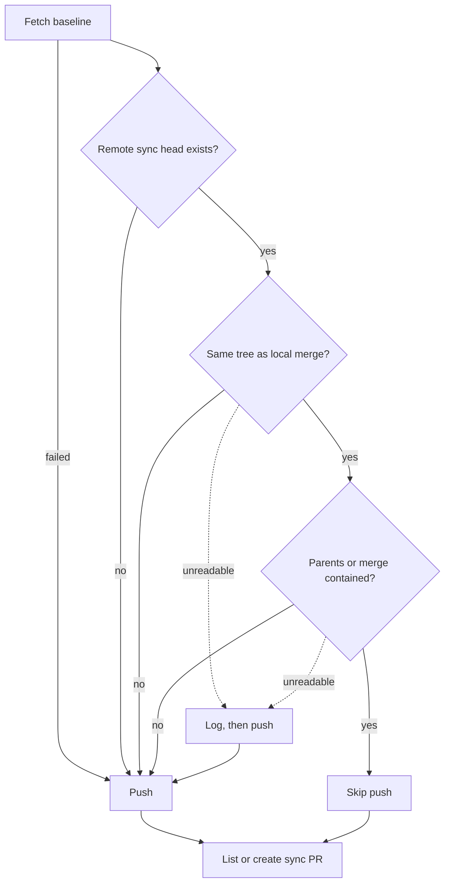

# Milestone Sync and Conflict PR Overhead

Evidence for Issue #3690: how many sync and conflict PRs milestones cost, which
of them repeat for no change, and what this change prevents. Branch protection
is never bypassed.

## Method

- Window: PRs created 2026-10-07 to 2026-10-14 (UTC), gathered 2026-10-15.
- PR lists: `gh pr list --state all --search "created:2026-10-07..2026-10-14"`.
- Per PR: `gh api repos/<repo>/issues/<n>/timeline` (`head_ref_force_pushed`
  events) and `gh api repos/<repo>/commits/<sha>` (parents of the sync head).
- VibeCoder is public and named. The other repository is called "private repo
  P1": counts only, no name, branch names, PR numbers or product detail.
- PRs are classed by head branch:

| Class | Head branch or title |
| --- | --- |
| Milestone sync | `sync/milestone-*` |
| Milestone fix (CI, review or conflict fix on the milestone, into the default branch) | `milestone-fix/*` |
| Milestone integration (milestone into the default branch) | `milestone/*` head |
| Conflict fix | head or title naming resolve, conflict or fallback |
| Implementation | `issue-*`, `feature-*` |
| Other | everything else (counted, never dropped) |

- CI fixes and review fixes on an ordinary issue PR land as commits on that
  PR, not separate PRs, so they are not separate rows here.
- Cost: Issue #3644's lifecycle ledger (sub-issues #3718 to #3723) is not on
  the default branch yet, so no per-issue API-equivalent cost is reported. The
  cost column is "unknown", never zero. CI runner minutes are reported for
  VibeCoder from the Actions API instead (sum of `updated_at` minus
  `run_started_at` per run, a wall-clock approximation).

## Baseline

| Repo | Implementation PRs merged | Sync PRs (merged/total) | Milestone-fix PRs (merged) | Milestone integration PRs (merged) | Conflict-fix PRs | Sync PRs per merged implementation PR | Median sync PR open to merge |
| --- | --- | --- | --- | --- | --- | --- | --- |
| VibeCoder | 110 | 32/32 | 42 | 14 | 1 | 0.29 | 10 min |
| private repo P1 | 149 | 86/87 | 66 | 23 (of 24) | 1 | 0.58 | 12 min |

Other PRs: VibeCoder 5, P1 73. Per-issue API-equivalent cost: unknown.

| Median open to merge | VibeCoder | P1 |
| --- | --- | --- |
| Implementation PR | 26 min | 30 min |
| Milestone integration PR | 780 min | 288 min |

Two other repos had 2 sync PRs each in the window.

### VibeCoder CI

Actions runs created 2026-10-07 to 2026-10-14: 1,980 runs.

| Head branch | Runs | Runner minutes (approx.) |
| --- | --- | --- |
| `issue-*` | 997 | 4,355 |
| `main` | 177 | 974 |
| `sync/milestone-*` | 74 | 342 |
| `milestone/*` | 118 | 536 |
| other | 614 | 1,679 |

Sync PRs were about 4% of VibeCoder CI runs (74/1,980) and about 4% of runner
minutes (342/7,886). Per merged implementation PR: 0.67 sync CI runs and about
3.1 sync runner minutes.

## What repeats

| # | Pattern | Observed | Addressed here |
| --- | --- | --- | --- |
| 1 | Identical sync re-pushed, restarting checks | 0 | Yes (guard) |
| 2 | No-op tree syncs | P1 only | No (open observation) |
| 3 | Overlapping sibling milestones | 10 of 32 | No (planning) |
| 4 | Fast-forward syncs | 14 of 32 | No (needed) |

1. **Identical re-push (same milestone tip and same default tip pushed twice).**
   None observed. Sync heads were force-pushed 2 times on VibeCoder (2 of 32
   sync PRs, for example #3648) and 9 times on P1 (8 of 87 sync PRs). The
   force-pushes inspected (VibeCoder #3648, and four P1 sync PRs) each carried
   a moved milestone tip or a moved default tip (for #3648 the default parent
   stayed `d744efc48` while the milestone parent moved to `d1cf7b90b`), so
   each was a real re-sync; the rest were not inspected one by one. The code path allowed the
   identical re-push, though: `raiseMilestoneSyncPr` force-pushed a fresh merge
   commit whenever any host merged, and the "last synced tip" record that stops
   a re-merge is per host. This change closes that path (next section).
2. **No-op tree syncs.** P1 merged 2 sync PRs that changed 0 files (one carried
   59 default-branch commits) and closed 1 more 0-file sync PR that had been
   retargeted to the default branch (handled by Issue #1967's retirement).
   VibeCoder: 0. Not prevented here: a 0-file merge still records the default
   branch in the milestone's ancestry, which the sync exists to do (Issue #1048,
   deletions become history rather than later conflicts). Skipping it would
   trade a roughly 10 minute CI run for a later conflict risk. Kept as an open
   observation.
3. **Overlapping sibling milestones.** VibeCoder had 5 pairs of sync PRs raised
   within 2 minutes of each other with identical diffs into two sibling
   milestones planned from one parent issue (#3413/#3414 and #3418/#3419 for
   #3385; #3736/#3737 and #3758/#3759 for #3644; #3763/#3764 for #3691): 10 of
   32 sync PRs. Each milestone branch needs its own sync to reach the default
   branch, so these are not redundant by identity. They are the cost of
   planning one parent into several concurrent milestones.
4. **Fast-forward syncs.** 14 of 32 VibeCoder sync PRs had a head that was a
   default-branch commit itself (the milestone branch had no commits of its own
   yet). They still need a PR because the ruleset's required status checks
   refuse a direct push; the fleet must not bypass it.

## Lifetime and overlap experiment

This change does not alter milestone lifetime, integration timing or the number
of overlapping milestone branches. Sibling milestones account for 10 of 32
VibeCoder sync PRs, and milestone integration PRs stay open far longer than
implementation PRs (median 780 min against 26 min on VibeCoder), but no
correlation or controlled before/after was computed. A planning-side change
needs the #3644 ledger to measure.

Preserved: milestone dependency checks, independent review, CI, rulesets and
no-force-push of protected branches. The guard only skips a push to the
unprotected `sync/milestone-*` branch.

## Prevented: identical sync re-push (this change)

`raiseMilestoneSyncPr` in `worker/deno/lib/milestone_sync_pr.ts` now reads the
remote `sync/milestone-<name>` head before force-pushing. When that head has
the same tree as the local merge and already contains the local merge's parents
(or the merge itself, for a fast-forward), nothing is pushed and the open sync
PR's checks keep running. The PR listing and creation run as before, so an
interrupted sync whose branch exists but whose PR was never opened still gets
its PR. The guard fails towards syncing: whenever it does not read "carries",
the push goes ahead as before. If `git rev-parse --verify --quiet` cannot
resolve `refs/remotes/origin/<branch>` (any non-zero exit, a missing branch or
an unreadable ref alike) the guard reads "differs" and pushes without a log
line. Once that ref resolves, a read that fails after it (a ref that is not a
full SHA, an unreadable tree, parent list or ancestry check) reads "unknown",
which is logged as "could not be read" before the push. The remote branch is
the shared, fleet-wide identity, so it covers sibling hosts and restarts that
the per-host tip record does not.

The comparison is only trusted after the baseline fetch of the sync branch
succeeds. When that fetch fails (no branch on the remote, or a network fault)
the push goes ahead as before.

## Before/after

- Before: the counts above.
- After: the guard prevents identical re-pushes, which were 0 in this window, so
  the expected reduction for the window is 0. This is a guard against a path
  the code allowed, not a measured saving.
- Re-measure with the same commands once #3644's ledger is on the default
  branch.

## Related

Issues #2298, #3035, #3013, #3617, #3644, #2030 (cross-host sync claim), #1967
(sync PR retirement), #1048 (merge commit ancestry) and #589 (sync PRs). This
document does not reimplement any of them.
