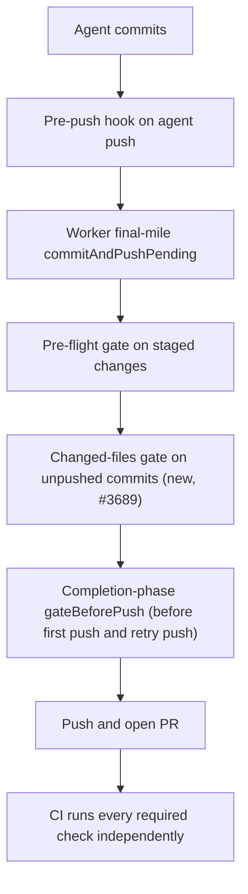

# Pre-PR Quality Stages vs Actual CI Failures

Evidence for Issue #3689, feeding the metrics in #3644. It audits whether the
worker's pre-PR quality stages would have caught the failures that GitHub CI
later reported on representative recent PRs in three repos.

## Method

For each PR below, the run is the **first failing required CI job** on the
named head SHA. For each, the audit asks whether a pre-PR worker stage ran an
equivalent command. The stages are:

- the pre-flight gate (`lib/pre_flight_gate.ts`);
- the agent pre-push hook (`lib/pre_push_gate.ts`, #3394);
- Step 1b of `commitAndPushPending` (`gateUnpushedCommits` -> `runPrePushGate`
  in `lib/git_push.ts`), which gates commits the agent already made before the
  worker pushes them;
- the issue worker's completion-phase gate (`gateBeforePush()` in
  `lib/phases/completion_phase.ts`), run before the first push and again before
  the retry push after `recoverFromPushRejection`;
- `quality.sh` / `lib/quality_gate.ts`;
- the end-to-end verifier (`lib/pre_pr_verifier.ts`).

Each failure is classed as one of:

- **local**: the worker can run the equivalent command itself.
- **network/credential-only**: needs a secret or a remote service the worker
  does not hold.
- **GitHub-exclusive**: depends on GitHub state (for example the base PR).

A stage that is skipped is reported as **SKIP**, never **PASS**.

Run links have the form
`https://github.com/stSoftwareAU/<repo>/actions/runs/<id>`. The dates are the
UTC run creation dates (2026-10-07 to 2026-10-13).

## The pre-PR path

## GRQ

| Run | First failing SHA | Check | Cause | Class | Pre-PR equivalent ran? | Outcome |
| --- | --- | --- | --- | --- | --- | --- |
| [38375639111](https://github.com/stSoftwareAU/GRQ/actions/runs/38375639111) | e9a7f8fd | Spelling | cspell: `pr-summary-5209.md:55` (fsmonitor, notrepo, emptyrepo) | local | No | Fixed by #3689 |
| [38462363800](https://github.com/stSoftwareAU/GRQ/actions/runs/38462363800) | 6b3eeaef | Spelling | cspell: `pr-summary-5221.md:39` (mawk) | local | No | Fixed by #3689 |
| [38030791481](https://github.com/stSoftwareAU/GRQ/actions/runs/38030791481) | 3e96c55d | Spelling | cspell: `pr-summary-5206.md:188` (unthresholded) | local | No | Fixed by #3689 |
| [37921633370](https://github.com/stSoftwareAU/GRQ/actions/runs/37921633370) | 3e313843 | Spelling | cspell: `pr-summary-5202.md:105` (unacted) | local | No | Fixed by #3689 |
| [38395012672](https://github.com/stSoftwareAU/GRQ/actions/runs/38395012672) | 65d0d714 | Spelling | cspell: `pr-summary-5225.md:28` (nosemgrep) | local | No | Fixed by #3689 |
| [37865294665](https://github.com/stSoftwareAU/GRQ/actions/runs/37865294665) | 9e39e325 | Spelling | cspell: `CHANGELOG.md:240` (backtester) | local | No | Fixed by #3689 |
| [37770312438](https://github.com/stSoftwareAU/GRQ/actions/runs/37770312438) | 26c8f269 | Spelling | cspell | local | No | Fixed by #3689 |
| [37687047960](https://github.com/stSoftwareAU/GRQ/actions/runs/37687047960) | 1f92a0af | Spelling | cspell | local | No | Fixed by #3689 |

The Spelling check runs cspell with `docs/cspell.json`. No pre-PR stage ran
cspell. #3689 adds a cspell check to the pre-push gate and pins cspell in the
worker image. A GRQ "Worker tests" failure is also class local and is already
covered by `quality.sh`.

## VibeCoder

| Run | First failing SHA | Check | Cause | Class | Pre-PR equivalent ran? | Outcome |
| --- | --- | --- | --- | --- | --- | --- |
| [38354507478](https://github.com/stSoftwareAU/VibeCoder/actions/runs/38354507478) | 45bf3c6f | `validate-scripts / validate`, Sweep ledger sweptAt ancestry | top-up-3535 recorded sweptAt d1cc7d24 | local | No | Fixed by #3689 |
| [38134932391](https://github.com/stSoftwareAU/VibeCoder/actions/runs/38134932391) | 1e432ed1 | same | top-up-3534 recorded sweptAt cff18ea3 | local | No | Fixed by #3689 |
| [38060624463](https://github.com/stSoftwareAU/VibeCoder/actions/runs/38060624463) | 817e49b5 | same | top-up-3394 recorded sweptAt 85b5ac7e | local | No | Fixed by #3689 |
| [38058126021](https://github.com/stSoftwareAU/VibeCoder/actions/runs/38058126021) | 1be1b9c0 | same | top-up-3382 recorded sweptAt 94f333b5 | local | No | Fixed by #3689 |
| [38051763868](https://github.com/stSoftwareAU/VibeCoder/actions/runs/38051763868) | a5553ff5 | same | top-up-3433 recorded sweptAt 4675510a | local | No | Fixed by #3689 |
| [38476298053](https://github.com/stSoftwareAU/VibeCoder/actions/runs/38476298053) | 035d0353 | markdownlint MD018 | `docs/USAGE.md:117` | local | No (ungated worker push, Step 2) | Fixed by Step 1b and the completion-phase gate (repos with a pre-flight spec) |
| [38074155287](https://github.com/stSoftwareAU/VibeCoder/actions/runs/38074155287) | 5f2a4e7b | markdownlint MD018 | `docs/mutation-check.md:147` | local | No (ungated worker push, Step 2) | Fixed by Step 1b and the completion-phase gate (repos with a pre-flight spec) |
| [38201375574](https://github.com/stSoftwareAU/VibeCoder/actions/runs/38201375574) | 958fc276 | gitleaks | secret scan | network/credential-only | No | Left to CI |
| [38123883049](https://github.com/stSoftwareAU/VibeCoder/actions/runs/38123883049) | c384c70e | semgrep | static analysis rules | network/credential-only | No | Left to CI |
| [38126786967](https://github.com/stSoftwareAU/VibeCoder/actions/runs/38126786967) | 9dfa6301 | type check and tests | compile or test failure | local | Covered by `quality.sh` | No change needed |
| [38345577457](https://github.com/stSoftwareAU/VibeCoder/actions/runs/38345577457) | 543adc87 | tests | runner disk full | local / runner infrastructure | Covered by `quality.sh` | Infrastructure |
| [38033819415](https://github.com/stSoftwareAU/VibeCoder/actions/runs/38033819415) | ab6a832f | Floci | AWS emulation, needs network | network/credential-only | No | Left to CI |

The sweptAt failures were a feature-branch commit recorded as the sweep
ledger's `sweptAt`, which is not an ancestor of the base branch. The check
needs deeper history than the shallow worker checkout has, and no pre-PR stage
checked ancestry. #3689 adds a sweptAt check to the pre-push gate that deepens
shallow history and fails closed, plus a rule in the `security_scan` prompt.

The agent pre-push hook runs markdownlint on the agent's own `git push`, and
markdownlint now also runs via Step 1b and the completion-phase gate when a
pre-flight spec exists. The two MD018 commits were pushed by the worker's
final-mile Step 2 (`pushUnpushedCommits` in `lib/git_push.ts`), which had no
changed-files gate. Issue #3689 gates the unpushed commits before that push
(Step 1b) and again in the completion phase, for repos with a pre-flight spec.
The completion-phase gate falls back to `{ commands: [] }` when no spec exists.

## GRQ-AutoTrader

| Run | First failing SHA | Check | Cause | Class | Pre-PR equivalent ran? | Outcome |
| --- | --- | --- | --- | --- | --- | --- |
| [38486741580](https://github.com/stSoftwareAU/GRQ-AutoTrader/actions/runs/38486741580) | a85026a6 | rustfmt | `handler.rs:67` | local | No (final-mile Step 2 gap) | Fixed by #3689 |
| [38484707749](https://github.com/stSoftwareAU/GRQ-AutoTrader/actions/runs/38484707749) | a3b78e09 | mermaid_blocks | invalid Mermaid block | local | Covered by `quality.sh` | No change needed |
| [38407346744](https://github.com/stSoftwareAU/GRQ-AutoTrader/actions/runs/38407346744) | 82d4a6fd | bootstrap drift | drift against the remote bootstrap | network-only | No | Left to CI |
| [38455750470](https://github.com/stSoftwareAU/GRQ-AutoTrader/actions/runs/38455750470) | 8b788065 | VERSION not bumped | compares to base PR state | GitHub-exclusive (compares against base PR state) | No | Left to CI — GRQ-AutoTrader's own `version-bump` job (#3248, closed) is the designed enforcer; no demonstrated pre-PR gap, no follow-up filed |
| [38357245453](https://github.com/stSoftwareAU/GRQ-AutoTrader/actions/runs/38357245453) | 2c0f586c | VERSION not bumped | compares to base PR state | GitHub-exclusive (compares against base PR state) | No | Left to CI — GRQ-AutoTrader's own `version-bump` job (#3248, closed) is the designed enforcer; no demonstrated pre-PR gap, no follow-up filed |

## Checks the worker cannot run

- **Network/credential-only**: gitleaks, semgrep, Floci (AWS emulation) and
  bootstrap drift.
- **GitHub-exclusive**: checks that compare against GitHub state, such as the
  base PR's VERSION. This check is left to CI's version-bump job (#3248); no
  pre-PR approximation exists or is claimed.

## Known remaining limits

- Step 1b is skipped only for callers with no pre-flight spec, such as
  WIP-preservation pushes; these are the ungated remainder. Repos with no
  pre-flight commands are still gated by the completion phase's
  `gateBeforePush()` using the changed-file checks.
- Network/credential-only checks (gitleaks, semgrep, bootstrap drift, Floci)
  are never reported as PASS locally. They are skipped, not passed.

CI still runs every required check independently after PR creation. Nothing in
Issue #3689 weakens or removes a CI, review or security gate.

## Method and limits of this audit

- Rows were derived from the failed GitHub Actions runs linked in the tables
  (first failing job per run, log read via `gh`).
- The rows for GRQ runs 37770312438 and 37687047960 record the failing check
  (Spelling/cspell), but the individual unknown words were not retained.
- No review-finding (blocking review) rows were audited, only CI jobs.
- Reproduction ran the equivalent local command against the checked-out failing
  file content in this repository's tests (fixtures), not by cloning each
  failing PR in a disposable checkout.
- The unattended worker path was verified by unit tests of `commitAndPushPending`
  Step 1b and the completion phase `gateBeforePush()`, not by a live end-to-end
  worker run.
- This evidence is the input #3644 consumes: per-repo tables with one row per
  failing run, giving the check name, first failing SHA, local, network or
  GitHub-exclusive class, and whether pre-flight ran an equivalent.
- Network/credential-only items (gitleaks, semgrep, bootstrap drift, Floci) have
  no follow-up filed because CI is their designed enforcer and no pre-PR gap was
  demonstrated.

## Out of scope

Issues #2945, #2932, #2968 and #3395 are not reimplemented, #3594 is
untouched, and the metrics in #3644 consume this evidence.
