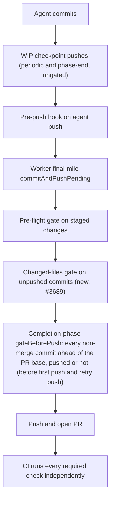

# Pre-PR Quality Stages vs Actual CI Failures

Evidence for Issues #3689 and #3717, feeding the metrics in #3644. It audits
whether the worker's pre-PR quality stages would have caught the CI failures
and blocking review findings that GitHub later reported on representative
recent PRs in three repos: VibeCoder and two private fleet repos, called
private-repo-A and private-repo-C here.

VibeCoder is public, so this document links and quotes only VibeCoder's runs,
reviews and code. A private repo's rows describe each failure at concept level,
with no repo name, PR, review, commit or run number, link, file path, code
identifier or product detail. The private evidence stays in those repos and on
the worker host that gathered it.

## Method

For each VibeCoder row below, the run is the **first failing required CI job**
on the named head SHA. For each row, the audit asks whether a pre-PR worker
stage ran an equivalent command. Private-repo rows carry a concept-level
failure ID (C1 to C8, A1 to A5) in place of a SHA and run link. The stages are:

- the pre-flight gate (`lib/pre_flight_gate.ts`);
- the agent pre-push hook (`lib/pre_push_gate.ts`, #3394);
- Step 1b of `commitAndPushPending` (`gateUnpushedCommits` -> `runPrePushGate`
  in `lib/git_push.ts`), which gates commits the agent already made before the
  worker pushes them. It sees only commits on no remote-tracking ref;
- the issue worker's completion-phase gate (`gateBeforePush()` in
  `lib/phases/completion_phase.ts`), run before the first push and again before
  the retry push after `recoverFromPushRejection`. It checks every non-merge
  commit the branch has ahead of the PR base, including commits the execute
  phase's WIP checkpoint pushes (periodic and phase-end, which are ungated)
  already put on origin. A block is reported with the worker-written prefix
  "the branch did not pass the worker's pre-push gate" ahead of the check
  output (redacted and cut to a few KB so the failure comment stays postable),
  so quoted diff hunks or test names cannot change the failure category. Only a
  verdict on the branch carries it; a failed git or remote lookup does not;
  see `docs/INTERNALS.md`;
- `quality.sh` / `lib/quality_gate.ts`;
- the end-to-end verifier (`lib/pre_pr_verifier.ts`).

Each failure is classed as one of:

- **local**: the worker can run the equivalent command itself.
- **network/credential-only**: needs a secret or a remote service the worker
  does not hold.
- **GitHub-exclusive**: depends on GitHub state (for example the base PR).

A stage that is skipped is reported as **SKIP**, never **PASS**.

VibeCoder run links have the form
`https://github.com/stSoftwareAU/VibeCoder/actions/runs/<id>`. The dates are
the UTC run creation dates (2026-10-07 to 2026-10-13).

## The pre-PR path



## private-repo-C

| Failure | Check | Cause | Class | Pre-PR equivalent ran? | Outcome |
| --- | --- | --- | --- | --- | --- |
| C1 | Spelling | cspell: unknown words in an archived PR summary | local | No (checkpoint push, ungated) | Fixed by the completion-phase whole-branch gate |
| C2 | Spelling | cspell: an unknown word in an archived PR summary | local | No (checkpoint push, ungated) | Fixed by the completion-phase whole-branch gate |
| C3 | Spelling | cspell: an unknown word in an archived PR summary | local | No | Fixed by the completion-phase whole-branch gate |
| C4 | Spelling | cspell: an unknown word in an archived PR summary | local | No (checkpoint push, ungated) | Fixed by the completion-phase whole-branch gate |
| C5 | Spelling | cspell: an unknown word in an archived PR summary | local | No (checkpoint push, ungated) | Fixed by the completion-phase whole-branch gate |
| C6 | Spelling | cspell: an unknown word in the changelog | local | No | Fixed by the completion-phase whole-branch gate |
| C7 | Spelling | cspell: an unknown word in a shell test | local | No | Fixed by the completion-phase whole-branch gate |
| C8 | Spelling | cspell: unknown words in a shell test | local | No | Fixed by the completion-phase whole-branch gate |

The Spelling check runs cspell with the repo's cspell config. No pre-PR stage
ran cspell. #3689 adds a cspell check to the pre-push gate and pins cspell in
the worker image. Three of the failing heads (C1, C4 and C5) are "WIP
checkpoint: periodic agent progress snapshot" commits and one (C2) is "Merge
remote WIP checkpoints": the execute phase's periodic and phase-end checkpoint
pushes (`commitAndPushPending` with no pre-flight spec) put the misspelt PR
summaries on origin before the completion phase ran. Those pushes stay ungated
on purpose, so work is never lost. The check therefore sits at the completion
phase, which gates every non-merge commit the branch has ahead of the PR base
(`git log --no-merges origin/<base>..HEAD`), pushed or not, before
`gh pr create`. `worker/deno/tests/git_push_preflight_test.ts` pins this with a
bad commit already on origin through a checkpoint push. A failure of the repo's
worker test job is also class local and is already covered by `quality.sh`.

## VibeCoder

| Run | First failing SHA | Check | Cause | Class | Pre-PR equivalent ran? | Outcome |
| --- | --- | --- | --- | --- | --- | --- |
| [38354507478](https://github.com/stSoftwareAU/VibeCoder/actions/runs/38354507478) | 45bf3c6f | `validate-scripts / validate`, Sweep ledger sweptAt ancestry | top-up-3535 recorded sweptAt d1cc7d24 | local | No | Fixed by #3689 |
| [38134932391](https://github.com/stSoftwareAU/VibeCoder/actions/runs/38134932391) | 1e432ed1 | same | top-up-3534 recorded sweptAt cff18ea3 | local | No | Fixed by #3689 |
| [38060624463](https://github.com/stSoftwareAU/VibeCoder/actions/runs/38060624463) | 817e49b5 | same | top-up-3394 recorded sweptAt 85b5ac7e | local | No | Fixed by #3689 |
| [38058126021](https://github.com/stSoftwareAU/VibeCoder/actions/runs/38058126021) | 1be1b9c0 | same | top-up-3382 recorded sweptAt 94f333b5 | local | No | Fixed by #3689 |
| [38051763868](https://github.com/stSoftwareAU/VibeCoder/actions/runs/38051763868) | a5553ff5 | same | top-up-3433 recorded sweptAt 4675510a | local | No | Fixed by #3689 |
| [38476298053](https://github.com/stSoftwareAU/VibeCoder/actions/runs/38476298053) | 035d0353 | markdownlint MD018 | `docs/USAGE.md:117` | local | No (ungated worker push, Step 2) | Fixed by Step 1b and the completion-phase gate (repos with a pre-flight spec) |
| [38074155287](https://github.com/stSoftwareAU/VibeCoder/actions/runs/38074155287) | 5f2a4e7b | markdownlint MD018 | `docs/mutation-check.md:147` | local | No (ungated worker push, Step 2) | Fixed by Step 1b and the completion-phase gate (repos with a pre-flight spec) |
| [38201375574](https://github.com/stSoftwareAU/VibeCoder/actions/runs/38201375574) | 958fc276 | gitleaks | `generic-api-key` in `worker/deno/tests/review_round_wiring_test.ts:47` (`leaks found: 1`) | local | No (no pre-PR gitleaks stage exists) | Gap, tracked in #3725 |
| [38123883049](https://github.com/stSoftwareAU/VibeCoder/actions/runs/38123883049) | c384c70e | semgrep | blocking `detect-non-literal-regexp` at `worker/deno/lib/mutation_gate.ts:627` (`SEMGREP_APP_TOKEN` empty) | local | A semgrep stage exists in `quality.sh` / `lib/quality_gate.ts` (Issue #559); whether it ran on c384c70e is not recorded; since Issue #3726 each gate stage's outcome is (see below) | Cause not recoverable; most likely #3730; recording added by #3726 |
| [38126786967](https://github.com/stSoftwareAU/VibeCoder/actions/runs/38126786967) | 9dfa6301 | type check and tests | compile or test failure | local | Covered by `quality.sh` | No change needed |
| [38345577457](https://github.com/stSoftwareAU/VibeCoder/actions/runs/38345577457) | 543adc87 | tests | runner disk full | local / runner infrastructure | Covered by `quality.sh` | Infrastructure |
| [38033819415](https://github.com/stSoftwareAU/VibeCoder/actions/runs/38033819415) | ab6a832f | Floci | `infra/cloudformation/test-floci.sh`: Floci `ValidationException` on a `PutParameter` name | local (baked `floci` binary) | No | Gap, tracked in #3727 |

The sweptAt failures were a feature-branch commit recorded as the sweep
ledger's `sweptAt`, which is not an ancestor of the base branch. The check
needs deeper history than the shallow worker checkout has, and no pre-PR stage
checked ancestry. #3689 adds a sweptAt check to the pre-push gate that deepens
shallow history and fails closed, plus a rule in the `security_scan` prompt.

The agent pre-push hook runs markdownlint on the agent's own `git push`.
markdownlint now also runs in the completion-phase gate, which covers the whole
branch (including checkpoint-pushed commits) and runs for every repo, and in
Step 1b, which runs only when a pre-flight spec exists. The two MD018 commits
were pushed by the worker's final-mile Step 2 (`pushUnpushedCommits` in
`lib/git_push.ts`), which had no changed-files gate. Issue #3689 gates the
unpushed commits before that push (Step 1b, pre-flight spec required) and again
in the completion phase (every repo). The completion-phase gate falls back to
`{ commands: [] }` when no spec exists.

## private-repo-A

| Failure | Check | Cause | Class | Pre-PR equivalent ran? | Outcome |
| --- | --- | --- | --- | --- | --- |
| A1 | rustfmt | a formatting diff in a Rust source file | local | No (final-mile Step 2 gap) | Fixed by #3689 |
| A2 | Mermaid blocks | an invalid Mermaid block | local | Covered by `quality.sh` | No change needed |
| A3 | bootstrap drift | drift against the remote bootstrap | network-only | No | Left to CI |
| A4 | VERSION not bumped | compares to base PR state | GitHub-exclusive (compares against base PR state) | No | Left to CI: the repo's own `version-bump` job is the designed enforcer; no demonstrated pre-PR gap, no follow-up filed |
| A5 | VERSION not bumped | compares to base PR state | GitHub-exclusive (compares against base PR state) | No | Left to CI: the repo's own `version-bump` job is the designed enforcer; no demonstrated pre-PR gap, no follow-up filed |

## Blocking review findings

Issue #3717 adds the review side. The table rows are the reviews still in
`CHANGES_REQUESTED` state when queried on 2026-10-15 at 07:11Z, on VibeCoderST
PRs opened in the three repos from 2026-10-07 to 2026-10-14. The query, per
repo, is `gh pr list -R stSoftwareAU/<repo> --author VibeCoderST --state all
--search "created:2026-10-07..2026-10-14" --limit 500 --json number,reviews`
(`--state all` includes PRs closed unmerged; the default `--limit` of 30 cuts
the list short). The 12 standing reviews on 11 PRs are all by
`stsoftware-pr-reviewer` (`/review-fleet-prs`). VibeCoder#3676's latest
review (5527925145) was standing when this table was first built and has
since been dismissed, so it is not a row.

The table is a sample of standing reviews, not a census. The same query
returns the reviews the fleet dismissed after the worker addressed them
(`select(.state=="DISMISSED")` on each PR's `reviews`):

| Repo | Standing `CHANGES_REQUESTED` | Dismissed |
| --- | --- | --- |
| private-repo-C | 0 reviews on 0 PRs | 22 reviews on 11 PRs |
| private-repo-A | 9 reviews on 8 PRs | 60 reviews on 31 PRs |
| VibeCoder | 3 reviews on 3 PRs | 105 reviews on 35 PRs |
| Total | 12 reviews on 11 PRs | 187 reviews on 77 PRs |

Each PR's issue timeline records the state a review had before it was
dismissed, in the `review_dismissed` event's `dismissed_review.state`:

```sh
gh api repos/stSoftwareAU/<repo>/issues/<n>/timeline --paginate \
  --jq '.[] | select(.event=="review_dismissed") | .dismissed_review.state'
```

Over the 77 PRs this gives 187 `review_dismissed` events, all
`changes_requested`, so every dismissed review counted here was a request for
changes. As a cross-check, all 187 bodies open with a `file:line` finding, as
the model reviews in the table do. Nothing in this audit reads the dismissed
set as a blocking-review rate. A reader of the table, including the metrics
in #3644, must not read private-repo-C's 0 as "no blocking findings": it had
no standing review, and 22 dismissed ones.

One private-repo-A PR was closed without merging and has one standing review;
it is listed in the table. The finding described is the first in the review.
For VibeCoder rows, PR head is the commit reviewed.

The dismissed set contains first-round reviews of heads the verifier had
checked, so a verifier miss can sit in it and not in the table.
[Pre-PR verifier: live runs](#pre-pr-verifier-live-runs) lists the misses
found there.

The pre-PR verifier (`lib/pre_pr_verifier.ts`, #3395) reached `main` on
2026-10-11 at 10:04Z (ac214bd7, the #3584 milestone merge). Only the issue
worker's completion phase calls it, so it does not check a milestone roll-up
PR (head `milestone/...`) or a PR-feedback round. A roll-up's children were
checked in their own issue runs; the child that introduced each line was not
traced.

A **judgement** finding needs the diff read against the code, the issue or a
previous release. That is the verifier's brief, and no executable check gives
it. **local** and **network-only** are as defined above.

| Review | PR head | First finding | Class | Pre-PR stage | Outcome |
| --- | --- | --- | --- | --- | --- |
| private-repo-A, PR 1 | - | the PR was based on the wrong branch, so its diff carried the whole milestone, including an unrelated permission change | judgement | PR-feedback round (milestone-fix branch); the verifier never runs on one | Closed without merging; left to review |
| private-repo-A, PR 2 | - | a derived figure was computed at a different cut-off from the values it is measured against | judgement | Milestone roll-up, opened before the verifier was deployed | Left to review |
| private-repo-A, PR 3 | - | a doc claimed a style rule applies at every screen width; the rule exists only inside one media query | judgement | Verifier deployed; the run was on another host, so whether it ran is not recorded | Left to review |
| private-repo-A, PR 4 | - | a Mermaid flowchart label mixing unquoted text with a quoted string does not parse | local | None: every CI check on the head passed, and VibeCoder's `check-mermaid` then passed the same block | Fixed by #3769 |
| private-repo-A, PR 5 | - | a new button sits under a full-card link overlay, so tapping it follows the link instead | judgement (rendered layout) | Verifier ran on this head (this host's log, 2026-10-13 15:01Z) and did not block | Verifier miss |
| private-repo-A, PR 6 | - | a top-of-page check ignores nested scrollers and fixed overlays | judgement | Milestone roll-up | Left to review |
| private-repo-A, PR 7 | - | a time range includes data from outside the intended session | judgement | Verifier deployed; run on another host, not recorded | Left to review |
| private-repo-A, PR 7 | - | new storage keys land where the previous release reads them and refuses | judgement (previous release) | Verifier deployed; run on another host, not recorded | Left to review |
| private-repo-A, PR 8 | - | the dependency-audit CI job was red; sent back without a model review | network-only (advisory database) | None: a CI check, not a review judgement | Left to CI and the CI-fix run |
| [VibeCoder#3440](https://github.com/stSoftwareAU/VibeCoder/pull/3440#pullrequestreview-5464965241) | 71a5356c | `worker/deno/lib/failure_diagnosis.ts:339`: the new gate-marker check runs after substring rules a quoted refusal can trip | judgement | Opened 2026-10-09, before the verifier was deployed | Left to review |
| [VibeCoder#3640](https://github.com/stSoftwareAU/VibeCoder/pull/3640#pullrequestreview-5498282324) | 459e991e | `worker/deno/lib/milestone_completion.ts:1347`: every scan rebuilds and re-edits an existing summary PR body, re-reading timelines uncached | judgement | Verifier deployed; run on another host, not recorded | Left to review |
| [VibeCoder#3707](https://github.com/stSoftwareAU/VibeCoder/pull/3707#pullrequestreview-5516189682) | ddc0ea4b | `prompts/issue/prompt.md:1399`: the facts-file switch contradicts the `pr-summary-check` instruction (the reviewer reproduced it with `pr_summary_check_cli`) | judgement | Milestone roll-up | Left to review |

## Unattended worker path

Issue #3717 checks the deployed stages on the path the unattended worker
takes, not only through unit tests.

### Executable checks: replay in disposable checkouts

The completion phase's `gateBeforePush()` calls
`gateUnpushedCommits(branch, { cwd }, spec, false, base)` (`lib/git_push.ts`).
Each replay made that same call with the worker code at this branch, inside
the worker container image (cspell, `markdownlint-cli2` v0.23.2, `cargo fmt`
and Deno 2.9.6 on `PATH`). It ran on a disposable blobless clone checked out
at the failing head. The base was the merge-base of that head with the PR's
base branch (the repo's default branch). The
spec was `{ commands: [] }`, the completion phase's fallback for a repo with
no pre-flight commands, so only the changed-file checks and the sweptAt check
ran. Repo-configured pre-flight commands come from a host's config and were
not replayed. Replays ran on 2026-10-15.

| Repo | Head | CI's first failure | Gate verdict | Gate output |
| --- | --- | --- | --- | --- |
| private-repo-C | C1 | Spelling | Block | cspell: the words CI reported, in the PR summary and a shell test |
| private-repo-C | C8 | Spelling | Block | `deno fmt --check` on a PR summary first; with `deno fmt` committed, cspell blocked on the words CI reported |
| VibeCoder | 035d0353 | markdownlint MD018 ([38476298053](https://github.com/stSoftwareAU/VibeCoder/actions/runs/38476298053)) | Block | `docs/USAGE.md:117:1 error MD018/no-missing-space-atx` |
| VibeCoder | 45bf3c6f | sweptAt ancestry ([38354507478](https://github.com/stSoftwareAU/VibeCoder/actions/runs/38354507478)) | Block | `slice top-up-3535 (#3535): sweptAt d1cc7d24… is not an ancestor of origin/main` |
| private-repo-A | A1 | rustfmt | Block | `cargo fmt --all --check`: the diff CI reported |
| VibeCoder | 958fc276 | gitleaks ([38201375574](https://github.com/stSoftwareAU/VibeCoder/actions/runs/38201375574)) | Pass (deno fmt, deno lint, markdownlint) | Expected: no pre-PR stage runs gitleaks, which confirms the gap tracked in #3725 |
| VibeCoder | 7ba349e5 | None: every CI check passed | Pass (deno fmt, deno lint, markdownlint) | Control: the gate does not block a head CI accepted |

private-repo-C's quality workflow applies `deno fmt` and commits the result
instead of failing on it, so on C8 the gate first stops on a check CI fixes
for itself. There the gate is stricter than CI, not weaker.

To rerun one row: `git clone --filter=blob:none` the repo, `git checkout -b
replay <sha>`, `git branch replay-base $(git merge-base <sha> origin/<base>)`,
then from `worker/deno`:

```sh
deno eval 'import { gateUnpushedCommits } from "./lib/git_push.ts"; const r = await gateUnpushedCommits("replay", { cwd: Deno.args[0] }, { commands: [] }, false, "replay-base"); console.log(r.ok ? "PASS" : r.error.message);' <checkout>
```

### Pre-PR verifier: live runs

This is single-host evidence: this worker host's logs from 2026-10-12 03:19Z
to 2026-10-15 03:11Z. Other hosts' logs were not read, so the counts are not
fleet-wide.

- The verifier raised a blocking finding on 18 issue runs in the three repos:
  2 in private-repo-C, 13 in private-repo-A, and VibeCoder#3535, #3652 and
  #3741. The finding reaches the worker's recovery or failure message, for
  example VibeCoder#3741: `Pre-PR verifier found 2 blocking finding(s):
  worker/deno/lib/issue_routing_classifier.ts:238`.
- `Pre-PR verifier blocked PR creation` was logged 6 times (5 private-repo-A
  runs and VibeCoder#3741).
- `not checked` was logged 0 times. `skipped: no PR summary file loaded` was
  logged twice (one private-repo-A run and one private-repo-C run); both runs
  then failed their completion gates.
- Three verifier misses are recorded, each a head the verifier ran on without
  blocking and a blocking review finding on that same head:
  - private-repo-A, PR 5 (standing review in the table above).
  - VibeCoder#3676, issue #3506: head d6203dc6 was committed at 12:10Z, the
    verifier ran at 12:13Z (no `Pre-PR verifier blocked` line), the PR was
    raised at 12:15Z, and review 5503578036 (12:35Z) found that
    `rederiveReportedGapSection` reuses a stale follow-up number. The worker
    later dismissed that review.
  - A second private-repo-A PR: the head was committed at 08:07Z, the
    verifier ran at 08:10Z to 08:11Z (no block line), and the first review
    (08:26Z) found that a cache invalidation dropped a marker the next step
    relies on. The worker later dismissed that review.
- These three are a lower bound, not the verifier's miss rate. They come from
  the first-round reviews of the 20 issues in the window whose runs on this
  host show a verifier checkout, and only where the review's head matches the
  commit the verifier saw (commit time before the verifier's first log line,
  no later commit before the review) and the run logged no block. The log
  line is an agent-progress tick that names the verifier's checkout path, so
  a verifier run too short to tick is missed. Two other private-repo-A PRs
  whose first review was dismissed were not counted: the verifier either
  checked a later head or blocked. Other hosts' logs were not read.

### Completion-phase pre-push gate: live runs

The whole-branch gate reached `main` with PR #3716 on 2026-10-14 at 22:20Z.
Four issue runs on this host then ran worker code that includes it (three in
private-repo-A, one in private-repo-C), and none logged
`Pre-push gate blocked the push`. One of the private-repo-A runs reached PR
recovery
(`IDEMPOTENT: recovering the PR`) at 03:06Z; `completionBody` gets there only
after `gateBeforePush()` returns no block. The gate logs nothing when it
passes, so the log cannot show which checks it reached on a live run. The
replay above is the evidence for its checks, and #3770 tracks a log line for
a pass.

## Checks the worker cannot run

- **Network/credential-only**: bootstrap drift (against the remote bootstrap).
- **GitHub-exclusive**: checks that compare against GitHub state, such as the
  base PR's VERSION. This check is left to the repo's own CI version-bump job; no
  pre-PR approximation exists or is claimed.

## Known remaining limits

- Step 1b runs only when the caller passes a pre-flight spec. It is skipped
  for WIP-preservation pushes, and for the PR processors' final-mile pushes
  (for example `lib/pr_ci_processor.ts`) in repos with no pre-flight
  commands, because `resolvePreFlightSpec` returns `undefined` for those
  repos; these pushes are the ungated remainder. Only the issue worker's
  completion phase falls back to an empty spec (`{ commands: [] }`), so on
  that path alone `gateBeforePush()` still runs the changed-file checks for a
  repo with no pre-flight commands.
- The WIP checkpoint pushes themselves are ungated on purpose. A bad file
  therefore reaches origin on the issue branch before the completion phase
  blocks it; the block happens before `gh pr create`, but a resumed or retried
  run can already have an open PR on the branch (`recoverExistingPr`), in which
  case a checkpoint push triggers CI on that PR before the gate blocks. If the base ref cannot be resolved the completion
  gate degrades to the unpushed-only check, and the ahead-of-base guard logs
  the unresolvable base as an error.
- Bootstrap drift is network-only and is never reported as PASS locally. It is
  skipped, not passed.
- Three VibeCoder failures (gitleaks, semgrep, Floci) need no secret or remote
  service, so they are class local and are open gaps, not closed rows:
  - gitleaks (run 38201375574): the CLI is pinned in the worker image
    (`container/tools.json`, `docs/CONTAINER.md`) and needs no network or
    licence, yet no pre-PR stage runs it (`lib/quality_gate.ts`,
    `lib/pre_push_gate.ts` and `quality.sh` have no gitleaks stage). Tracked in
    #3725.
  - semgrep (run 38123883049): the failure was a real blocking finding with no
    credential involved. The local semgrep stage (`runSemgrepQualityCheck`,
    `lib/semgrep_check.ts`, Issue #559) runs the same `p/default` ruleset over
    changed `.ts` files, and semgrep has been in the image since 2026-09-17, so
    scope does not explain the miss. Whether the stage ran, was SKIPPED
    (offline registry, deadline) or never ran on c384c70e is not recoverable:
    the worker's gate output was not retained in the CI log or the PR, and the
    worker recorded only "quality gate: passed on attempt N". The finding was
    fixed by a later commit (6f256dd8). The most likely cause, though not
    proven, is #3730 (open): when the merge-base with origin/HEAD cannot be
    resolved (for example a shallow checkout whose origin default branch has
    moved), `resolveDiffBase` in `lib/semgrep_check.ts` falls back to HEAD, so a
    change the agent already committed is not in the scanned set and the stage
    reports PASSED with "no scannable changed files since HEAD". What is now
    recorded (Issue #3726): the run-stats comment's `quality gate stages:` line
    and the worker log's "Quality gate stage outcomes" line state each stage as
    passed, skipped (with its redacted reason) or failed, so a later CI-only
    failure can be matched to a SKIPPED local stage. Inside the fleet container
    a missing semgrep binary is now FAILED, while the registry and deadline
    cases stay SKIPPED and are recorded.
  - Floci (run 38033819415): a deterministic `ValidationException` from
    `infra/cloudformation/test-floci.sh`, reproducible with the baked `floci`
    binary. No pre-PR stage runs it. Tracked in #3727.
- The pre-PR stages had no executable Mermaid parse that caught a flowchart
  label mixing unquoted text with a quoted string (found by a private-repo-A
  review); VibeCoder's own validator passed it. Fixed by #3769, which adds
  that check to the validator.
- The pre-push gate logs nothing on a pass, so its checks on live runs are not
  observable in the worker log. Tracked in #3770.

CI still runs every required check independently after PR creation. Nothing in
Issue #3689 weakens or removes a CI, review or security gate.

## Method and limits of this audit

- Rows were derived from the failed GitHub Actions runs in the tables (first
  failing job per run, log read via `gh`). Only VibeCoder's runs are linked.
- Blocking review findings are audited in their own table (Issue #3717); the
  verifier's live record comes from one host's logs only.
- Fixtures in this repository's tests reproduce each fixed gap. Issue #3717
  also replayed the completion-phase gate on seven real heads in disposable
  checkouts (see Unattended worker path).
- The unattended worker path is verified by unit tests of Step 1b and
  `gateBeforePush()`, by the disposable-checkout replay, and by this host's
  worker logs (see Unattended worker path). No live run on this host has yet
  logged a pre-push gate block, and the gate logs nothing on a pass (#3770).
- #3644 consumes two kinds of evidence. The CI tables have one row per failing
  run. VibeCoder rows give the check name, first failing SHA, run link, local,
  network or GitHub-exclusive class, and whether pre-flight ran an equivalent.
  Private-repo rows give the check name, cause, class and pre-PR outcome under
  a concept-level failure ID (C1 to C8, A1 to A5), with no SHA or run link. The review
  table has one row per standing review, with its class and pre-PR stage, and
  no private-repo-C row because it has no standing review. #3644 takes the
  per-repo dismissed counts from the separate table in "Blocking review
  findings", where private-repo-C's standing count is 0 against 22 dismissed.
- Bootstrap drift and the GitHub-exclusive VERSION-not-bumped check are left to
  CI with no follow-up, because they need the remote bootstrap or base PR state
  and no pre-PR gap was demonstrated. The gitleaks, semgrep and
  Floci rows are local and have follow-ups (#3725, #3726, #3727); they are not
  fixed by #3689.
- The cause of the semgrep miss could not be established from the logs (see
  above); #3730 is the most likely cause but is not proven. Issue #3726 records
  each stage's outcome from now on, so the next such miss is diagnosable.

## Out of scope

Issues #2945, #2932, #2968 and #3395 are not reimplemented, #3594 is
untouched, and the metrics in #3644 consume this evidence.
