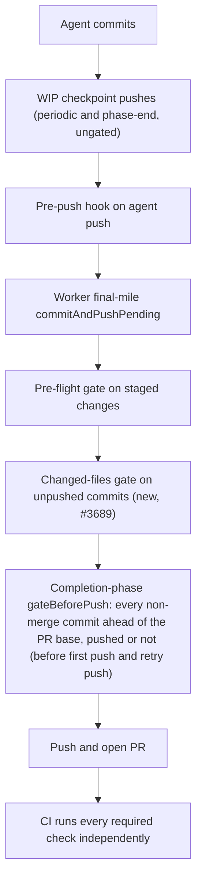

# Pre-PR Quality Stages vs Actual CI Failures

Evidence for Issue #3689, feeding the metrics in #3644. It audits whether the
worker's pre-PR quality stages would have caught the failures that GitHub CI
later reported on representative recent PRs in three repos.

## Method

For each PR below, the run is the **first failing required CI job** on the
named head SHA. For each, the audit asks whether a pre-PR worker stage ran an
equivalent command. The stages are:

- the pre-flight gate (`lib/pre_flight_gate.ts`);
- the agent pre-push hook (`lib/pre_push_gate.ts`, #3394);
- Step 1b of `commitAndPushPending` (`gateUnpushedCommits` -> `runPrePushGate`
  in `lib/git_push.ts`), which gates commits the agent already made before the
  worker pushes them. It sees only commits on no remote-tracking ref;
- the issue worker's completion-phase gate (`gateBeforePush()` in
  `lib/phases/completion_phase.ts`), run before the first push and again before
  the retry push after `recoverFromPushRejection`. It checks every non-merge
  commit the branch has ahead of the PR base, including commits the execute
  phase's WIP checkpoint pushes (periodic and phase-end, which are ungated)
  already put on origin. A block is reported with the worker-written prefix
  "the branch did not pass the worker's pre-push gate" ahead of the check
  output (redacted and cut to a few KB so the failure comment stays postable),
  so quoted diff hunks or test names cannot change the failure category. Only a
  verdict on the branch carries it; a failed git or remote lookup does not;
  see `docs/INTERNALS.md`;
- `quality.sh` / `lib/quality_gate.ts`;
- the end-to-end verifier (`lib/pre_pr_verifier.ts`).

Each failure is classed as one of:

- **local**: the worker can run the equivalent command itself.
- **network/credential-only**: needs a secret or a remote service the worker
  does not hold.
- **GitHub-exclusive**: depends on GitHub state (for example the base PR).

A stage that is skipped is reported as **SKIP**, never **PASS**.

Run links have the form
`https://github.com/stSoftwareAU/<repo>/actions/runs/<id>`. The dates are the
UTC run creation dates (2026-10-07 to 2026-10-13).

## The pre-PR path

## GRQ

| Run | First failing SHA | Check | Cause | Class | Pre-PR equivalent ran? | Outcome |
| --- | --- | --- | --- | --- | --- | --- |
| [38375639111](https://github.com/stSoftwareAU/GRQ/actions/runs/38375639111) | e9a7f8fd | Spelling | cspell: `pr-summary-5209.md:55` (fsmonitor, notrepo, emptyrepo) | local | No (checkpoint push, ungated) | Fixed by the completion-phase whole-branch gate |
| [38462363800](https://github.com/stSoftwareAU/GRQ/actions/runs/38462363800) | 6b3eeaef | Spelling | cspell: `pr-summary-5221.md:39` (mawk) | local | No (checkpoint push, ungated) | Fixed by the completion-phase whole-branch gate |
| [38030791481](https://github.com/stSoftwareAU/GRQ/actions/runs/38030791481) | 3e96c55d | Spelling | cspell: `pr-summary-5206.md:188` (unthresholded) | local | No | Fixed by the completion-phase whole-branch gate |
| [37921633370](https://github.com/stSoftwareAU/GRQ/actions/runs/37921633370) | 3e313843 | Spelling | cspell: `pr-summary-5202.md:105` (unacted) | local | No (checkpoint push, ungated) | Fixed by the completion-phase whole-branch gate |
| [38395012672](https://github.com/stSoftwareAU/GRQ/actions/runs/38395012672) | 65d0d714 | Spelling | cspell: `pr-summary-5225.md:28` (nosemgrep) | local | No (checkpoint push, ungated) | Fixed by the completion-phase whole-branch gate |
| [37865294665](https://github.com/stSoftwareAU/GRQ/actions/runs/37865294665) | 9e39e325 | Spelling | cspell: `CHANGELOG.md:240` (backtester) | local | No | Fixed by the completion-phase whole-branch gate |
| [37770312438](https://github.com/stSoftwareAU/GRQ/actions/runs/37770312438) | 26c8f269 | Spelling | cspell | local | No | Fixed by the completion-phase whole-branch gate |
| [37687047960](https://github.com/stSoftwareAU/GRQ/actions/runs/37687047960) | 1f92a0af | Spelling | cspell | local | No | Fixed by the completion-phase whole-branch gate |

The Spelling check runs cspell with `docs/cspell.json`. No pre-PR stage ran
cspell. #3689 adds a cspell check to the pre-push gate and pins cspell in the
worker image. e9a7f8fd, 3e313843 and 65d0d714 are
"WIP checkpoint: periodic agent progress snapshot" commits and 6b3eeaef is
"Merge remote WIP checkpoints" (read with `gh api repos/stSoftwareAU/GRQ/commits/<sha>`):
the execute phase's periodic and phase-end checkpoint pushes
(`commitAndPushPending` with no pre-flight spec) put the misspelt PR summaries
on origin before the completion phase ran. Those pushes stay ungated on
purpose, so work is never lost. The check therefore sits at the completion
phase, which gates every non-merge commit the branch has ahead of the PR base
(`git log --no-merges origin/<base>..HEAD`), pushed or not, before
`gh pr create`. `worker/deno/tests/git_push_preflight_test.ts` pins this with a
bad commit already on origin through a checkpoint push. A GRQ "Worker tests" failure is also class local and is already
covered by `quality.sh`.

## VibeCoder

| Run | First failing SHA | Check | Cause | Class | Pre-PR equivalent ran? | Outcome |
| --- | --- | --- | --- | --- | --- | --- |
| [38354507478](https://github.com/stSoftwareAU/VibeCoder/actions/runs/38354507478) | 45bf3c6f | `validate-scripts / validate`, Sweep ledger sweptAt ancestry | top-up-3535 recorded sweptAt d1cc7d24 | local | No | Fixed by #3689 |
| [38134932391](https://github.com/stSoftwareAU/VibeCoder/actions/runs/38134932391) | 1e432ed1 | same | top-up-3534 recorded sweptAt cff18ea3 | local | No | Fixed by #3689 |
| [38060624463](https://github.com/stSoftwareAU/VibeCoder/actions/runs/38060624463) | 817e49b5 | same | top-up-3394 recorded sweptAt 85b5ac7e | local | No | Fixed by #3689 |
| [38058126021](https://github.com/stSoftwareAU/VibeCoder/actions/runs/38058126021) | 1be1b9c0 | same | top-up-3382 recorded sweptAt 94f333b5 | local | No | Fixed by #3689 |
| [38051763868](https://github.com/stSoftwareAU/VibeCoder/actions/runs/38051763868) | a5553ff5 | same | top-up-3433 recorded sweptAt 4675510a | local | No | Fixed by #3689 |
| [38476298053](https://github.com/stSoftwareAU/VibeCoder/actions/runs/38476298053) | 035d0353 | markdownlint MD018 | `docs/USAGE.md:117` | local | No (ungated worker push, Step 2) | Fixed by Step 1b and the completion-phase gate (repos with a pre-flight spec) |
| [38074155287](https://github.com/stSoftwareAU/VibeCoder/actions/runs/38074155287) | 5f2a4e7b | markdownlint MD018 | `docs/mutation-check.md:147` | local | No (ungated worker push, Step 2) | Fixed by Step 1b and the completion-phase gate (repos with a pre-flight spec) |
| [38201375574](https://github.com/stSoftwareAU/VibeCoder/actions/runs/38201375574) | 958fc276 | gitleaks | `generic-api-key` in `worker/deno/tests/review_round_wiring_test.ts:47` (`leaks found: 1`) | local | No (no pre-PR gitleaks stage exists) | Gap, tracked in #3725 |
| [38123883049](https://github.com/stSoftwareAU/VibeCoder/actions/runs/38123883049) | c384c70e | semgrep | blocking `detect-non-literal-regexp` at `worker/deno/lib/mutation_gate.ts:627` (`SEMGREP_APP_TOKEN` empty) | local | A semgrep stage exists in `quality.sh` / `lib/quality_gate.ts` (Issue #559); whether it ran on c384c70e is not recorded | Unexplained miss, tracked in #3726 |
| [38126786967](https://github.com/stSoftwareAU/VibeCoder/actions/runs/38126786967) | 9dfa6301 | type check and tests | compile or test failure | local | Covered by `quality.sh` | No change needed |
| [38345577457](https://github.com/stSoftwareAU/VibeCoder/actions/runs/38345577457) | 543adc87 | tests | runner disk full | local / runner infrastructure | Covered by `quality.sh` | Infrastructure |
| [38033819415](https://github.com/stSoftwareAU/VibeCoder/actions/runs/38033819415) | ab6a832f | Floci | `infra/cloudformation/test-floci.sh`: Floci `ValidationException` on a `PutParameter` name | local (baked `floci` binary) | No | Gap, tracked in #3727 |

The sweptAt failures were a feature-branch commit recorded as the sweep
ledger's `sweptAt`, which is not an ancestor of the base branch. The check
needs deeper history than the shallow worker checkout has, and no pre-PR stage
checked ancestry. #3689 adds a sweptAt check to the pre-push gate that deepens
shallow history and fails closed, plus a rule in the `security_scan` prompt.

The agent pre-push hook runs markdownlint on the agent's own `git push`.
markdownlint now also runs in the completion-phase gate, which covers the whole
branch (including checkpoint-pushed commits) and runs for every repo, and in
Step 1b, which runs only when a pre-flight spec exists. The two MD018 commits
were pushed by the worker's final-mile Step 2 (`pushUnpushedCommits` in
`lib/git_push.ts`), which had no changed-files gate. Issue #3689 gates the
unpushed commits before that push (Step 1b, pre-flight spec required) and again
in the completion phase (every repo). The completion-phase gate falls back to
`{ commands: [] }` when no spec exists.

## GRQ-AutoTrader

| Run | First failing SHA | Check | Cause | Class | Pre-PR equivalent ran? | Outcome |
| --- | --- | --- | --- | --- | --- | --- |
| [38486741580](https://github.com/stSoftwareAU/GRQ-AutoTrader/actions/runs/38486741580) | a85026a6 | rustfmt | `handler.rs:67` | local | No (final-mile Step 2 gap) | Fixed by #3689 |
| [38484707749](https://github.com/stSoftwareAU/GRQ-AutoTrader/actions/runs/38484707749) | a3b78e09 | mermaid_blocks | invalid Mermaid block | local | Covered by `quality.sh` | No change needed |
| [38407346744](https://github.com/stSoftwareAU/GRQ-AutoTrader/actions/runs/38407346744) | 82d4a6fd | bootstrap drift | drift against the remote bootstrap | network-only | No | Left to CI |
| [38455750470](https://github.com/stSoftwareAU/GRQ-AutoTrader/actions/runs/38455750470) | 8b788065 | VERSION not bumped | compares to base PR state | GitHub-exclusive (compares against base PR state) | No | Left to CI — GRQ-AutoTrader's own `version-bump` job (#3248, closed) is the designed enforcer; no demonstrated pre-PR gap, no follow-up filed |
| [38357245453](https://github.com/stSoftwareAU/GRQ-AutoTrader/actions/runs/38357245453) | 2c0f586c | VERSION not bumped | compares to base PR state | GitHub-exclusive (compares against base PR state) | No | Left to CI — GRQ-AutoTrader's own `version-bump` job (#3248, closed) is the designed enforcer; no demonstrated pre-PR gap, no follow-up filed |

## Checks the worker cannot run

- **Network/credential-only**: bootstrap drift (against the remote bootstrap).
- **GitHub-exclusive**: checks that compare against GitHub state, such as the
  base PR's VERSION. This check is left to CI's version-bump job (#3248); no
  pre-PR approximation exists or is claimed.

## Known remaining limits

- Step 1b runs only when the caller passes a pre-flight spec. It is skipped
  for WIP-preservation pushes, and for the PR processors' final-mile pushes
  (for example `lib/pr_ci_processor.ts`) in repos with no pre-flight
  commands, because `resolvePreFlightSpec` returns `undefined` for those
  repos; these pushes are the ungated remainder. Only the issue worker's
  completion phase falls back to an empty spec (`{ commands: [] }`), so on
  that path alone `gateBeforePush()` still runs the changed-file checks for a
  repo with no pre-flight commands.
- The WIP checkpoint pushes themselves are ungated on purpose. A bad file
  therefore reaches origin on the issue branch before the completion phase
  blocks it; the block happens before `gh pr create`, but a resumed or retried
  run can already have an open PR on the branch (`recoverExistingPr`), in which
  case a checkpoint push triggers CI on that PR before the gate blocks. If the base ref cannot be resolved the completion
  gate degrades to the unpushed-only check, and the ahead-of-base guard logs
  the unresolvable base as an error.
- Bootstrap drift is network-only and is never reported as PASS locally. It is
  skipped, not passed.
- Three VibeCoder failures (gitleaks, semgrep, Floci) need no secret or remote
  service, so they are class local and are open gaps, not closed rows:
  - gitleaks (run 38201375574): the CLI is pinned in the worker image
    (`container/tools.json`, `docs/CONTAINER.md`) and needs no network or
    licence, yet no pre-PR stage runs it (`lib/quality_gate.ts`,
    `lib/pre_push_gate.ts` and `quality.sh` have no gitleaks stage). Tracked in
    #3725.
  - semgrep (run 38123883049): the failure was a real blocking finding with no
    credential involved. The local semgrep stage (`runSemgrepQualityCheck`,
    `lib/semgrep_check.ts`, Issue #559) runs the same `p/default` ruleset over
    changed `.ts` files, and semgrep has been in the image since 2026-09-17, so
    scope does not explain the miss. Whether the stage ran, was SKIPPED
    (offline registry, deadline) or never ran on c384c70e is not recoverable:
    the worker's gate output is not retained in the CI log or the PR. The
    finding was fixed by a later commit (6f256dd8). Tracked in #3726.
  - Floci (run 38033819415): a deterministic `ValidationException` from
    `infra/cloudformation/test-floci.sh`, reproducible with the baked `floci`
    binary. No pre-PR stage runs it. Tracked in #3727.

CI still runs every required check independently after PR creation. Nothing in
Issue #3689 weakens or removes a CI, review or security gate.

## Method and limits of this audit

- Rows were derived from the failed GitHub Actions runs linked in the tables
  (first failing job per run, log read via `gh`).
- The rows for GRQ runs 37770312438 and 37687047960 record the failing check
  (Spelling/cspell), but the individual unknown words were not retained.
- No review-finding (blocking review) rows were audited, only CI jobs.
- Reproduction ran the equivalent local command against the checked-out failing
  file content in this repository's tests (fixtures), not by cloning each
  failing PR in a disposable checkout.
- The unattended worker path was verified by unit tests of `commitAndPushPending`
  Step 1b and the completion phase `gateBeforePush()` (including a bad commit
  already pushed by a checkpoint), not by a live end-to-end worker run.
- This evidence is the input #3644 consumes: per-repo tables with one row per
  failing run, giving the check name, first failing SHA, local, network or
  GitHub-exclusive class, and whether pre-flight ran an equivalent.
- Bootstrap drift and the GitHub-exclusive VERSION-not-bumped check are left to
  CI with no follow-up, because they need the remote bootstrap or base PR state
  and no pre-PR gap was demonstrated. The gitleaks, semgrep and
  Floci rows are local and have follow-ups (#3725, #3726, #3727); they are not
  fixed by #3689.
- The cause of the semgrep miss could not be established from the logs (see
  above), so the semgrep row is an unexplained miss, not a diagnosed one.

## Out of scope

Issues #2945, #2932, #2968 and #3395 are not reimplemented, #3594 is
untouched, and the metrics in #3644 consume this evidence.
