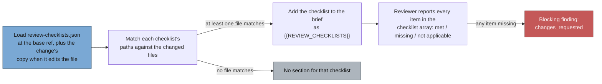

# Repository review checklists

A repository can own a short, path-scoped list of things every change to part of
it must satisfy, and have both the fleet PR reviewer and the worker's pre-PR
verifier hold each PR to it (Issue #3594). It is for rules a generic reviewer
cannot know: "money figures are never `f64`", "a release change bumps the
changelog".

## Where it lives

`review-checklists.json` at the root of the target repository.

It is read at the **base ref** of the change:

- the pre-PR verifier runs `git show <baseSha>:review-checklists.json`;
- the fleet reviewer fetches it through the GitHub contents API at the PR's base
  branch.

A PR therefore cannot weaken its own checklist. A PR that edits
`review-checklists.json` is judged against the base version, and the edit takes
effect once it merges, except when either copy is broken (see the table below).

When the changed files include `review-checklists.json` (or the list is unknown),
both consumers also read the change's own copy (`git show <headSha>:…` in the
verifier, the contents API at the PR's head SHA in the fleet gate), so a broken
file can neither merge nor strand the repo. One shared function,
`effectiveChecklistLoad`, decides which copy applies:

| Base copy               | Change's copy                | Judged on                                              |
| ----------------------- | ---------------------------- | ------------------------------------------------------ |
| any                     | not touched by the change    | the base copy                                          |
| absent or valid         | valid, absent or weakened    | the base copy (a change cannot weaken its checklist)   |
| any                     | malformed or unreadable      | the change's copy: a blocking finding naming the error |
| malformed or unreadable | valid                        | the change's copy: the change is the repair            |
| malformed or unreadable | removes the file             | no checklist: the change is the repair                 |
| fetch failed (either)   | any                          | retried / "not checked", as for any failed fetch       |

## Format

```json
{
  "checklists": [
    {
      "name": "Money figures",
      "paths": ["src/money/**", "**/*price*.rs"],
      "items": [
        "Every money figure uses integer cents or Decimal, never f64",
        "Rounding happens once, at the boundary, and a test pins the mode"
      ]
    },
    {
      "name": "Release",
      "paths": ["Cargo.toml", "CHANGELOG.md", ".github/workflows/release*.yml"],
      "items": [
        "The version in Cargo.toml was bumped and matches the CHANGELOG heading",
        "The CHANGELOG entry says what changed for a user, not what files moved"
      ]
    }
  ]
}
```

Each checklist needs a non-empty `name`, a non-empty `paths` array of globs and
a non-empty `items` array of strings. A glob that can never match is rejected
too: after a leading `./` is dropped, it must not start with `/`, contain `//`,
end with `/` or have a `..` segment. Anything else is a schema error (see
[Failure behaviour](#failure-behaviour)).

## How it is applied



For every checklist with at least one changed file matching one of its `paths`,
the reviewer reports **every** item in a `checklist` array of its reply JSON as
`met`, `missing` or `not applicable`, each with a note, the same way it reports
acceptance criteria. A `missing` item is also a blocking finding, so the outcome
is `changes_requested`. A diff touching no listed path gets no checklist section
at all.

## Glob rules

| Rule         | Behaviour                                                                                                                                               |
| ------------ | ------------------------------------------------------------------------------------------------------------------------------------------------------- |
| `**`         | Crosses `/`. `**/` also matches zero directories, so `**/*price*.rs` matches `price.rs` at the root                                                     |
| `*`          | Matches any run of characters except `/`                                                                                                                |
| `?`          | Matches exactly one character that is not `/`                                                                                                           |
| Case         | Case-sensitive                                                                                                                                          |
| Leading `./` | Stripped from the path and the glob before matching                                                                                                     |
| Unsafe paths | A changed path with a `..` segment, an empty segment (`//` or a trailing `/`), or a leading `/` never matches; such a glob in `paths` is a schema error |

## Failure behaviour

The code, not the model, makes a checklist that was not applied visible. The
brief still tells the reviewer to report a BLOCKING finding, but both consumers
also add one themselves, so a reply with no findings and no `checklist` array is
never an approval:

- the load problem (malformed, undecodable, or an unknown changed-file list)
  becomes a blocking finding on `review-checklists.json` (line 1);
- every item the brief rendered that the reply gave no verdict is named in one
  further blocking finding. An item is matched to its verdict by checklist name
  and item text, ignoring case, spacing and a leading `1.`.

The fleet reviewer lists the findings in the posted review (`changes_requested`)
and the pre-PR verifier in its gate comment. A PR that adds or leaves a
malformed file is sent back and cannot merge it. If a broken file is already on
the base branch, every PR that does not edit it is sent back, but a PR that
edits it is judged on its own copy, so the repair can be reviewed and merged.

A failed _fetch_ is different: it says nothing about the file and may be
transient (a timeout, HTTP 5xx, a rate limit). The fleet gate skips that PR for
the pass (`skipped["checklist-unreadable"]`, with a line in `upkeep`) so the
next pass retries it; the pre-PR verifier returns "not checked", as it does for
any run it cannot complete.

| Situation                                          | Result                                                                  |
| -------------------------------------------------- | ----------------------------------------------------------------------- |
| File absent (not found at the base ref)            | Nothing happens; no checklist section                                   |
| A change adds or leaves a malformed file           | Code-added blocking finding naming the parse error                      |
| A change repairs a malformed base file             | Judged on its own copy; the base problem is not raised for it           |
| Present, but no changed file matches any checklist | Nothing happens; no checklist section                                   |
| Malformed JSON or invalid schema                   | BLOCKING instruction in the brief and a code-added blocking finding     |
| Contents reply that cannot be decoded              | The same                                                                |
| Changed-file list unavailable or truncated         | The same, because matching cannot be trusted                            |
| Reply leaves an item without a verdict             | Code-added blocking finding naming the item                             |
| Fetch failed (any gh/git error but not-found)      | Fleet: PR skipped and retried next pass. Pre-PR verifier: "not checked" |

## Who consumes it

Both consumers share one loader,
[`worker/deno/lib/review_checklists.ts`](../worker/deno/lib/review_checklists.ts)
(parse, glob match, render the section, parse the verdict), and one brief,
[`prompts/pr_review_brief/prompt.md`](../prompts/pr_review_brief/prompt.md),
which takes the rendered section as its fifth field, `{{REVIEW_CHECKLISTS}}`.

- **Pre-PR verifier**
  ([`worker/deno/lib/pre_pr_verifier.ts`](../worker/deno/lib/pre_pr_verifier.ts);
  see
  [issue-processing.md](workflows/issue-processing.md#pre-pr-verifier-issue-3395)).
  A `missing` verdict blocks the PR even when the reply has no matching finding
  (`prePrVerifierBlocked`), and is listed in the block reason and in the gate
  comment that reaches the in-run recovery turn. A reply with no `checklist`
  array is parsed as `[]`, and every item it then lacks a verdict for is a
  blocking finding the verifier adds itself (see
  [Failure behaviour](#failure-behaviour)).
- **Fleet reviewer** (the `review-fleet-prs` skill under
  `.claude/skills/review-fleet-prs/`). The review comment gains a "Repository
  review checklists" section listing each item with its verdict, on approved
  reviews too. A `missing` item makes the outcome `changes_requested`, as does a
  load problem or an item with no verdict (`post.ts` adds those findings from
  the gate entry's `checklistState`).

## Testing

Tests live in `worker/deno/tests/`. Run the checklist tests (named for issue
3594) and the shared-brief test with stdin closed:

```sh
deno test --allow-all worker/deno/tests/*checklists_3594_test.ts \
  worker/deno/tests/pr_review_brief_shared_3395_test.ts \
  worker/deno/tests/pre_pr_verifier_3395_test.ts < /dev/null
```

To try a checklist by hand, put a `review-checklists.json` on a repository's
default branch, open a PR touching a matching path, and confirm the section
appears; then open one touching no listed path and confirm it does not.
