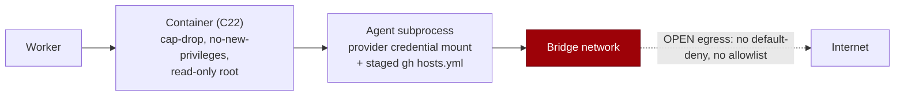

# 🔬 Agent containment best practices vs VibeCoder — gap analysis

**Status:** reference gap analysis for Issue #3652. Point-in-time. The verdicts
are recorded and follow-ups #3698–#3703 are filed.

**Comparison axis:** _containment of the running agent_ — sandbox, network,
credentials, permissions, run limits, monitoring and incident response. It does
not compare detection or scanning methods.

**Sources compared.**

- **Anthropic** —
  [Agent containment best practices (private beta)](https://support.claude.com/en/articles/17316076-agent-containment-best-practices-getting-started-private-beta).
- **VibeCoder** — [`docs/THREAT-MODEL.md`](../THREAT-MODEL.md),
  [`SECURITY.md`](../../SECURITY.md), and the code files cited below:
  `worker/deno/lib/container_runtime.ts`, `container_launch.ts`,
  `agent_provider.ts`, `config.ts`, `config_defaults.ts`, `agent_transcript.ts`,
  `worker_log_cleanup.ts` and `gh_credential_stage.ts`. Line numbers are at base
  `f108cad7`.

**Scope.** Defensive only. No sandbox-escape attempt is run and no worker code
changes with this document.

## The run boundary today

## Mapping

| Harness capability                                                 | VibeCoder status                                                                                        | Where                                                           |
| ------------------------------------------------------------------ | ------------------------------------------------------------------------------------------------------- | --------------------------------------------------------------- |
| Hardware-virtualised sandbox, one microVM per agent                | Partial: hardened container on Docker/Podman; own VM only on Apple `container`. No escape test recorded | `container_runtime.ts`, `container_launch.ts`, THREAT-MODEL C22 |
| Egress denied by default, with an allowlist                        | Gap: bridge network, open outbound                                                                      | `container_runtime.ts:344-346`, `container_launch.ts:1145-1146` |
| No credential-bearing mounts; credential added by an outside proxy | Gap: credentials are readable in the container                                                          | THREAT-MODEL R9, R11                                            |
| Auto permission mode as an extra check                             | Skipped: the container is the permission boundary                                                       | `agent_provider.ts:604`                                         |
| Turn and run-time limits                                           | Partial: run-time limit only                                                                            | `config.ts:604-605`                                             |
| Transcript per stage, kept 30+ days, scanned on a schedule         | Gap: 3-day retention, no scan                                                                           | `agent_transcript.ts`, `worker_log_cleanup.ts`                  |
| Incident process                                                   | Gap: no agent-incident runbook                                                                          | `SECURITY.md`                                                   |

## Gaps and recommendations

### G1 — Sandbox — **ADOPT**

- **Article claim:** a hardware-virtualised sandbox, one microVM per agent, and
  a supervised sandbox-escape test per new host, sandbox change or model.
- **VibeCoder today:** the OCI runtime (Docker; Podman via `PODMAN_DIALECT`) in
  `worker/deno/lib/container_runtime.ts` launches with `--cap-drop ALL`
  (`worker/deno/lib/container_launch.ts:1149`), `no-new-privileges` (`:1151`)
  and a read-only root (`:1166`). `APPLE_DIALECT`
  (`container_runtime.ts:400-415`) runs each container in its own VM and sets
  `supportsCapDrop: false` and `supportsReadOnly: false`. C22 is at
  `docs/THREAT-MODEL.md:199`.
- **Gap:** no escape test has been run or recorded against the actual boundary.
- **Verdict:** ADOPT the supervised test; it is the cheapest way to learn how
  strong C22 really is. The deliverable is a human-run test plan only, with no
  autonomous escape attempt. → **follow-up filed: #3703.**

### G2 — Network — **ADOPT**

- **Article claim:** egress denied by default, with an allowlist.
- **VibeCoder today:** `container_runtime.ts:344-346` sets
  `networkMode: "bridge"`. `container_launch.ts:1145-1146` comments "outbound
  only" and pushes `--network` only when `dialect.networkMode` is set
  (`APPLE_DIALECT` sets none). C12 and C13 (`THREAT-MODEL.md:189-190`) govern
  only `gh` writes, not general egress.
- **Gap:** no default-deny egress and no allowlist.
- **Verdict:** ADOPT; open egress is what turns every other leak into
  exfiltration. → **follow-up filed: #3698.**

### G3 — Credentials — **ADOPT**

- **Article claim:** no credential-bearing mounts; the model credential is added
  by a proxy outside the sandbox.
- **VibeCoder today:** the provider credential mount is readable in the
  container (THREAT-MODEL R9, `:241`). The staged `gh` `hosts.yml` is readable
  (R11, `:243`; `worker/deno/lib/gh_credential_stage.ts`; #1440, closed). The
  model credential is not added by an outside proxy.
- **Gap:** the agent subprocess can read the credential, and egress is open, so
  a stolen token can reach an attacker (see G2).
- **Verdict:** ADOPT; R9 and R11 accept this risk only because egress was
  assumed controlled. → **follow-up filed: #3699.**

### G4 — Permissions — **SKIP**

- **Article claim:** auto permission mode as an extra check.
- **VibeCoder today:** the agent runs with `--dangerously-skip-permissions`
  (`worker/deno/lib/agent_provider.ts:604`) plus a `--disallowed-tools` list
  (`:607`). The container is the permission boundary.
- **Gap:** no classifier-based extra check.
- **Verdict:** SKIP; auto mode depends on Anthropic-side classifier features
  that Claude Code CLI runs cannot verify.

### G5 — Run limits — **ADOPT**

- **Article claim:** turn and run-time limits.
- **VibeCoder today:** no turn limit. Run time is bounded by `claudeTimeout`
  (`worker/deno/lib/config.ts:604-605`), default 3600 s
  (`worker/deno/lib/config_defaults.ts:205`).
- **Gap:** no per-run turn cap.
- **Verdict:** ADOPT; a turn cap bounds a looping agent well before the hour is
  up. → **follow-up filed: #3701.**

### G6 — Monitoring — **ADOPT**

- **Article claim:** a transcript per agent stage kept at least 30 days and
  scanned on a schedule.
- **VibeCoder today:** transcripts are kept 3 days with a 200-file cap
  (`worker/deno/lib/agent_transcript.ts:28-38`;
  `worker/deno/lib/worker_log_cleanup.ts:34`, `:37`); `agent_transcript.ts:59`
  caps one transcript at 100 MiB. Nothing scans them on a schedule.
- **Gap:** 3-day retention against 30 days, and no scheduled scan.
- **Verdict:** ADOPT; without retention and a scan, an incident cannot be
  reconstructed or detected. → **follow-up filed: #3700.**

### G7 — Incidents — **ADOPT**

- **Article claim:** an incident process.
- **VibeCoder today:** `SECURITY.md` has no agent-incident runbook. Its sections
  are Threat Model (`:28`), Process Isolation (`:94`), Guarded Outbound Fetches
  (`:154`), Secret Redaction (`:301`) and Configuration Security (`:660`).
- **Gap:** no runbook.
- **Verdict:** ADOPT; a short runbook is cheap and needed once G2, G3 and G6
  land. → **follow-up filed: #3702.**

### Skipped gaps (recorded, not adopted)

| Gap                                                                           | Harness origin               | Why skip                                                                                                                                                                       |
| ----------------------------------------------------------------------------- | ---------------------------- | ------------------------------------------------------------------------------------------------------------------------------------------------------------------------------ |
| Anthropic-account items (escape-classifier score; notifying the account team) | Anthropic account feature    | The fleet runs the Claude Code CLI, where the score is not available                                                                                                           |
| Auto permission mode (G4)                                                     | Auto permission mode         | The container is the permission boundary; depends on Anthropic-side classifier features                                                                                        |
| microVM for every agent on Linux                                              | Hardware-virtualised sandbox | C22 already gives cap-dropped, read-only, non-privileged containers; a VM runtime per host is a platform migration larger than the gap; #3703 measures the real boundary first |

**Related claims.** R6 (`THREAT-MODEL.md:239`) and R13 (`:246`) mention egress
control via C12/C13. R6 now carries a pointer to R9 and #3698 (C12/C13 cover
`gh` writes only). R13 claims only that RTK adds no exposure relative to the
existing controls, not that egress control stops exfiltration, so it has no
pointer. Both are related to G2.

## Summary

1. Seven areas were compared against the article; six are ADOPT and one is SKIP.
2. G1 Sandbox — ADOPT: supervised escape test plan (#3703).
3. G2 Network — ADOPT: default-deny egress with an allowlist (#3698).
4. G3 Credentials — ADOPT: keep credentials out of the agent's reach (#3699).
5. G4 Permissions — SKIP: the container is the permission boundary.
6. G5 Run limits — ADOPT: per-run turn cap (#3701).
7. G6 Monitoring — ADOPT: longer transcript retention and a scheduled scan
   (#3700).
8. G7 Incidents — ADOPT: agent-incident runbook (#3702).
9. Skipped: Anthropic-account items, auto permission mode, and a microVM for
   every agent on Linux.
