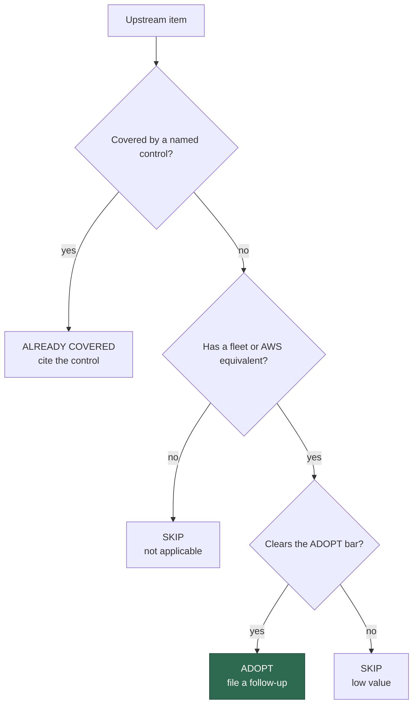

# Security Constitution vs VibeCoder — gap analysis

**Status:** reference gap analysis for Issue #4653. Point-in-time. The verdicts
are recorded and one follow-up is filed: #4817.

**Upstream:**
[KatTraxler/security-constitution](https://github.com/KatTraxler/security-constitution/tree/3f2d969a6e4905535bab85331fc5beb6587d1837),
pinned at commit `3f2d969a6e4905535bab85331fc5beb6587d1837`. The upstream
repository has no licence. Each row paraphrases an idea and is attributed by
its id or title only; no upstream text is copied.

**Read.** The upstream README, `security-constitution.md` and the three
Phase-1 registers, in their Markdown editions. The JSON editions were not read
separately. Nothing was executed.

**Comparison axis:** the upstream principles, lessons, design shapes, discovery
signals and feature-abuse negatives, against VibeCoder's coding guidelines,
scan design lenses and threat model. It does not compare tooling.

**VibeCoder surfaces assessed.**

1. Secure Coding Principles in `prompts/coding_guidelines/prompt.md:445`, and
   the capability bundle `prompts/coding_guidelines/capability-security.json`
   (entry `capsec-resource-auth`, described as "resource and tenant
   authorisation" in `docs/CAPABILITY-SECURITY-GUIDANCE.md`).
   `CODING-STANDARDS.md` carries no copy of the Secure Coding Principles
   section.
2. The design lenses in `prompts/security_scan/prompt.md`.
3. `docs/THREAT-MODEL.md`, which treats the worker as a deputy.

Line numbers are at base `5083cead` and will drift.

## Method and the ADOPT bar

Each upstream item gets one verdict:

- **ALREADY COVERED** cites the control that already covers the item.
- **ADOPT** means the item fills a gap no current control covers, names the
  file and the concrete change, adds at most 150 words to any one prompt, adds
  no human step, approval gate or `needs-human` path, and stays per-repo.
- **SKIP** says why: the item does not apply, or its value is low.

Upstream shapes, signals and negatives are written for GCP, Azure and OCI
managed services. Each is mapped to its AWS IaC analysis
(`worker/deno/lib/cloud_permission_chains.ts` and the "Cloud permission chains
(AWS IaC)" section of `prompts/security_scan/prompt.md`) or to a GitHub-token
equivalent. Otherwise it is SKIP, with the reason given.

At most three follow-ups are allowed, one per file changed. Zero is valid.

The ADOPT bar in the last question means: a gap, a named file and change, at
most 150 words, and no human step.

## Result

The table has 34 verdicts. Three ADOPTs are all bundled into follow-up #4817 on
`prompts/security_scan/prompt.md`.

| Verdict         | Count | Rows                                                                                                                                       |
| --------------- | ----- | ------------------------------------------------------------------------------------------------------------------------------------------ |
| ADOPT           | 3     | L4, SHAPE-021, SHAPE-032                                                                                                                   |
| ALREADY COVERED | 23    | P1, P2, P3, P5, P7, P8, P9, P10, P12, L1, L2, L3, L6, L7, L8, L9, L10, SHAPE-001, SHAPE-016, SIGNAL-001, SIGNAL-015, FA-003, FA-006        |
| SKIP            | 8     | P4, P6, P11, L5, L11, SHAPE-013, SIGNAL-010, FA-010                                                                                        |

No ADOPT touches the coding guidelines, `CODING-STANDARDS.md` or
`docs/THREAT-MODEL.md`, so no twin edit is owed. The deputy and
resource-authority ideas are already carried by `capsec-resource-auth`, A01 and
the THREAT-MODEL C-controls. Adding prose to the always-loaded guidelines would
cost every run.

### Secure coding principles (P1–P12)

| Item | Upstream idea (paraphrased)                                  | Verdict         | Evidence / reason                                                                                                                                                                                                                                                                                  |
| ---- | ------------------------------------------------------------ | --------------- | -------------------------------------------------------------------------------------------------------------------------------------------------------------------------------------------------------------------------------------------------------------------------------------------------- |
| P1   | Authorise at every trust boundary                            | ALREADY COVERED | Scan A01 authorisation gaps (`prompts/security_scan/prompt.md:413`); `capsec-resource-auth`; THREAT-MODEL C1–C3 and C12 at each GitHub surface.                                                                                                                                                  |
| P2   | Security actions are auditable and attributed to the initiator | ALREADY COVERED | THREAT-MODEL C16 tamper-evident audit journal (`worker/deno/lib/audit_entry.ts`); `worker/deno/lib/acting_github_user.ts`; scan A09 logging.                                                                                                                                                 |
| P3   | Least privilege for humans and non-human identities          | ALREADY COVERED | "Principle of Least Privilege" (`prompts/coding_guidelines/prompt.md:452`; not copied to `CODING-STANDARDS.md`); THREAT-MODEL C12, C13, C20 and C21; the `workflow-permissions` check (`worker/deno/lib/workflow_file_checks.ts`). Closed #4633 and #4659. Open #4692 (checkout credential kept in fleet dependency-update templates) is cited, not duplicated. |
| P4   | Customers can restrict or disable risky functionality        | SKIP            | Not applicable: an obligation of a vendor toward its customers. The fleet is not a multi-customer platform. A06 already flags a missing control the threat model requires (`prompts/security_scan/prompt.md:696`).                                                                                  |
| P5   | Tenant isolation                                             | ALREADY COVERED | A01 tenant boundary leakage (`prompts/security_scan/prompt.md:413`); feature-abuse tenancy gate (`:1133`); Repository Isolation rule (`prompts/coding_guidelines/prompt.md:181`); THREAT-MODEL A4. Issue #4737 (closed; an untrusted account can replace a shared clone's git directory) is a tracked defect, not a missing control. |
| P6   | Internal protocols held to public-API standards              | SKIP            | Low value. Aimed at vendor-internal protocols exposed on customer infrastructure. The nearest fleet case, a check enforced only by the client, is already A01 broken function-level authorisation (`prompts/security_scan/prompt.md:413`). No concrete change is worth its prompt cost.                |
| P7   | Credential lifecycle governance                              | ALREADY COVERED | Scan A07 weak invalidation after revocation (`prompts/security_scan/prompt.md:886`); worker-side C21 provisioning and recorded residual risk R11 (staged `gh` credential not run-scoped). Issue #4705 (closed) owns declared credential transport.                                                  |
| P8   | Bounded blast radius for delegation                          | ALREADY COVERED | THREAT-MODEL C12 per-run write-repo allowlist; C25 identity guard (`worker/deno/lib/identity_guard.ts`); AWS `assume-role-escalation` chain (`prompts/security_scan/prompt.md:1238`).                                                                                                             |
| P9   | Verify the caller's authority in the target domain           | ALREADY COVERED | `capsec-resource-auth` (authorise the caller against the resource's tenant or owner in the real entry point); A01 IDOR (`prompts/security_scan/prompt.md:413`).                                                                                                                                  |
| P10  | Secret custody follows secret use                            | ALREADY COVERED | THREAT-MODEL C20 (child environment denies credential-shaped variables; `worker/deno/lib/untrusted_command_env.ts`), C21, C36 and R11; `worker/deno/lib/checkout_persist_credentials_scanner.ts`. Closed #4633 and #4659; #4705 (closed) and open #4692 are cited, not duplicated.              |
| P11  | Network references are protected resources                   | SKIP            | No fleet equivalent. The AWS analogue is a service attaching a caller-named VPC or subnet, which the role-only scope of the AWS IaC section (`prompts/security_scan/prompt.md:1220`) does not model. The worker's own network is C35 default-deny egress and the C30 SSRF guard.                        |
| P12  | Cross-service authorisation needs an assigned enforcer       | ALREADY COVERED | `capsec-resource-auth` for generated code; THREAT-MODEL C12 and C13 for the worker's single GitHub hop. Issue #4731 (closed; babysitter runner follows agent-planted symlinks) is a concrete instance, tracked there, not a gap in the controls.                                                 |

### Operational lessons (L1–L11)

| Item | Upstream idea (paraphrased)                                    | Verdict         | Evidence / reason                                                                                                                                                                                                                                                                                                                                                                                  |
| ---- | -------------------------------------------------------------- | --------------- | -------------------------------------------------------------------------------------------------------------------------------------------------------------------------------------------------------------------------------------------------------------------------------------------------------------------------------------------------------------------------------------------------- |
| L1   | Cross-domain authority translation                             | ALREADY COVERED | As P9. The AWS form (a `Create*` permission versus data-plane access through a service role) is the `passrole-compute` chain (`prompts/security_scan/prompt.md:1239`).                                                                                                                                                                                                                             |
| L2   | Linked-resource deputy test                                    | ALREADY COVERED | `capsec-resource-auth` and A01 IDOR for caller-named references; `passrole-compute` for the AWS role form.                                                                                                                                                                                                                                                                                         |
| L3   | Authorisation present but insufficient                         | ALREADY COVERED | Phase 3 hostile re-read that tries to refute a finding from static evidence (`prompts/security_scan/prompt.md:1533`); `capsec-resource-auth` requires that a legitimate authorised update still succeeds; G1 in `docs/security/idle-task-scans-vs-anthropic-visa-harnesses-gap-analysis.md`.                                                                                                       |
| L4   | Provider-recommended configuration as an attack precondition   | **ADOPT** (AWS slice only) | A grep of `prompts/security_scan/prompt.md`, `docs/` outside the archive and `worker/deno/lib/cloud_permission_chains.ts` finds no check for a trust or resource policy that names an AWS service principal with no `aws:SourceArn` or `aws:SourceAccount` condition. Follow-up #4817. The GCP and Azure materiality-weighting table is not adopted (vendor severity calibration). |
| L5   | Reasonable-customer test                                       | SKIP            | Low value. A severity-calibration heuristic for a vendor bounty programme. Scan severity follows Phase 3 step 5 (blast radius), and extra words cost every run.                                                                                                                                                                                                                                  |
| L6   | Six-condition deputy graduation                                | ALREADY COVERED | "A lone permission is never a finding", and a chain must reach a privileged target role (`prompts/security_scan/prompt.md:1236`–`1241`). Chains required by documented intent are dropped (`:1233`–`1235`), the customer-consented exclusion.                                                                                                                                                  |
| L7   | Non-exportable is not non-exploitable                          | ALREADY COVERED | The control premise is use, not extraction. C20 and C21 keep credentials out of the agent environment; THREAT-MODEL AP-11 and R11 record the residual.                                                                                                                                                                                                                                            |
| L8   | Exploit-primitive requirement                                  | ALREADY COVERED | "Trace the impact before reporting — a flag is not a finding" (`prompts/security_scan/prompt.md:1149`–`1155`).                                                                                                                                                                                                                                                                                    |
| L9   | Customer-consented composition is not a confused deputy        | ALREADY COVERED | Documented-intent drop (`prompts/security_scan/prompt.md:1233`–`1235`).                                                                                                                                                                                                                                                                                                                             |
| L10  | Speculative impact chains are a documentation signal           | ALREADY COVERED | Confidence is lowered when a condition is visible (`prompts/security_scan/prompt.md:1253`); an independent verifier runs for high and critical findings (G1, delivered).                                                                                                                                                                                                                             |
| L11  | Shared cross-tenant deputy is the highest-severity class       | SKIP            | Vendor severity calibration. The AWS slice, a service principal with no source condition, is carried by the L4 ADOPT.                                                                                                                                                                                                                                                                              |

### Design shapes (SHAPE)

| Item        | Upstream idea (paraphrased)                                                              | Verdict         | Evidence / reason                                                                                                                                                                                                                                                                                                                 |
| ----------- | ---------------------------------------------------------------------------------------- | --------------- | --------------------------------------------------------------------------------------------------------------------------------------------------------------------------------------------------------------------------------------------------------------------------------------------------------------------------------- |
| SHAPE-001   | A managed service exercises its permissions on a caller-supplied referent                | ALREADY COVERED | `capsec-resource-auth` and A01 IDOR. The AWS form is `passrole-compute`. Upstream says the shape does not port to documented AWS service-role workflows. The AWS service-principal slice is the L4 ADOPT.                                                                                                                       |
| SHAPE-013   | A caller-supplied network attachment lets a shared connector enter a network             | SKIP            | No equivalent; see P11. GCP private-service-connect specific.                                                                                                                                                                                                                                                                     |
| SHAPE-016   | A caller binds a customer-managed run-as identity without the attachment gate            | ALREADY COVERED | The AWS analogue, `iam:PassRole`, is the `passrole-compute` chain (`prompts/security_scan/prompt.md:1239`; `worker/deno/lib/cloud_permission_chains.ts`).                                                                                                                                                                        |
| SHAPE-021   | A read method returns a secret-bearing field under only a coarse read permission         | **ADOPT**       | The feature-abuse lens covers export, search and preview leakage but has no secret-bearing-field read parity. Follow-up #4817, `prompts/security_scan/prompt.md`, merged into one bullet with SHAPE-032.                                                                                                                          |
| SHAPE-032   | A caller can retarget the endpoint a deputy sends a stored secret to                     | **ADOPT**       | The lens's webhook bullet (`prompts/security_scan/prompt.md:1201`) treats the URL only as SSRF. It does not ask whether editing the endpoint requires the right to retrieve the secret sent to it. Follow-up #4817, same bullet as SHAPE-021.                                                                                    |

### Discovery signals (SIGNAL)

| Item        | Upstream idea (paraphrased)                                                              | Verdict         | Evidence / reason                                                                                                                                                                                                                                                                                                                 |
| ----------- | ---------------------------------------------------------------------------------------- | --------------- | --------------------------------------------------------------------------------------------------------------------------------------------------------------------------------------------------------------------------------------------------------------------------------------------------------------------------------- |
| SIGNAL-001  | A service agent acts on a referenced resource                                            | ALREADY COVERED | As SHAPE-001.                                                                                                                                                                                                                                                                                                                     |
| SIGNAL-010  | A managed service reaches private resources through a caller-supplied network attachment | SKIP            | No equivalent; as SHAPE-013.                                                                                                                                                                                                                                                                                                      |
| SIGNAL-015  | A caller-supplied run-as service account on a binding or activation method               | ALREADY COVERED | As SHAPE-016.                                                                                                                                                                                                                                                                                                                     |

### Feature-abuse true negatives (FA)

| Item   | Upstream idea (paraphrased)                                  | Verdict         | Evidence / reason                                                                                                                                                                                                                                                                       |
| ------ | ------------------------------------------------------------ | --------------- | --------------------------------------------------------------------------------------------------------------------------------------------------------------------------------------------------------------------------------------------------------------------------------------- |
| FA-003 | Managed-identity runtime authority granted by the customer   | ALREADY COVERED | Documented-intent drop (`prompts/security_scan/prompt.md:1233`–`1235`) and the customer-consented rule (L9). Azure itself has no IaC analysis here.                                                                                                                                      |
| FA-006 | Service-account impersonation lateral movement               | ALREADY COVERED | Its AWS equivalent is `assume-role-escalation` (`prompts/security_scan/prompt.md:1238`). The GCP form is out of scope.                                                                                                                                                               |
| FA-010 | OCI dynamic groups and instance-principal inheritance        | SKIP            | No equivalent: the fleet has no OCI IaC analysis. The nearest AWS form, an instance role reached by SendCommand, is the `ssm-send-command` chain (`prompts/security_scan/prompt.md:1240`).                                                                                             |

### Also considered (not counted among the 34)

- **Calibration guidance** (design flaw versus feature abuse versus classic
  bug; negative calibration signals): ALREADY COVERED by L3, L6, L8 and L9, and
  by the lens's "flag is not a finding" discipline.
- **"Hypothesise statically, validate by execution":** SKIP. The scan is static
  by design (`prompts/security_scan/prompt.md:1221`–`1222`: no live cloud
  calls, no credential testing). Execution against live infrastructure needs
  authority the worker deliberately does not hold. The in-repo analogue is the
  hostile re-read (L3), and incomplete evidence is reported "not checked"
  (`:1226`–`1228`).
- **Anchors A1–A13:** a synthesis layer over the principles and lessons, not a
  separate item. Each maps to a row above. A8 (name squatting), A9 (hierarchy
  cascade), A11 (derived-state ACL, covered for RAG by LLM08,
  `prompts/security_scan/prompt.md:1385`) and A12 (temporal binding, covered for
  approval edits by THREAT-MODEL AP-7) have no further gap that clears the bar.

## Follow-up filed

**#4817** — "Security scan prompt: add secret-bearing field gate and AWS
service-principal source-condition checks".

- File: `prompts/security_scan/prompt.md` only. Not twinned with
  `CODING-STANDARDS.md`.
- Budget: at most 150 added words in total.
- Two bullets: one in the feature-abuse lens covering SHAPE-021 and SHAPE-032;
  one in the AWS IaC section covering L4.
- No human step is added.
- Cap check: 1 of 3 allowed follow-ups used.

## Limits

- The upstream JSON registers were not read separately.
- Coverage claims come from reading the cited files and from a grep of the
  prompts, docs and `worker/deno/lib/cloud_permission_chains.ts` for
  `SourceArn`, `SourceAccount` and `confused deputy`. The scan was not run.
- Line numbers are at base `5083cead` and will drift.
- Upstream may change after the pinned commit.
