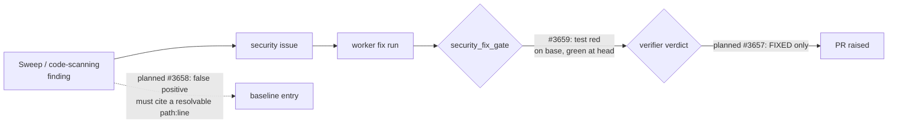

# 🔎 VulnHunter methodology vs VibeCoder's security workflow

**Status:** reference evaluation for Issue #3623. Point-in-time; no worker code
changed with it. Each adopt verdict is tracked by its own follow-up issue.

**Sources compared.**

- **VulnHunter** — [`nealbridges/VulnHunter`](https://github.com/nealbridges/VulnHunter)
  at commit
  [`b91b81e6`](https://github.com/nealbridges/VulnHunter/tree/b91b81e696a756e8a3d9ea69248b469b834a2f92)
  (2026-10-09). Paths below are relative to that tree. VulnHunter ships three
  agent skills: `/vulnhunt` (hunt), `/vulnhunter-fix` (fix) and
  `/vulnhunt-fix-verify` (verify).
- **VibeCoder** — three surfaces only, as agreed on #3623:
  - `worker/deno/lib/security_fix_gate.ts` — the PR-time gate on a PR that
    closes a `security` finding;
  - `worker/deno/lib/security_tree_sweep.ts` — the whole-tree worker-scan +
    semgrep + CodeQL sweep, its baseline and its issue filing;
  - `worker/deno/lib/alert_feeds/code_scanning_alerts.ts` — the open
    high/critical code-scanning alert feed.

  Line numbers are taken from the base this report was written against
  (`dd497e46`).

**Scope.** Defensive techniques only. Each row is judged against two open
failure classes: **#3512** (a run edits, loosens or deletes a check so its own
gate goes green) and **#3615** (a guard treats a failed read as "does not
apply" and lets the action through; #3613 is one instance). Attacker-first
forward analysis and running VulnHunter itself as a tool were scoped out
on #3623.

## Verdicts at a glance

| # | Technique | Verdict | Follow-up | Closes #3512? | Closes #3615? |
| - | --------- | ------- | --------- | ------------- | ------------- |
| 1 | Falsification engine | **Skip** | — | No | No |
| 2 | Independent verifier | **Adopt** | #3657 | No — narrows it on the security-fix surface | No |
| 3 | Evidence/capability filter | **Adopt** | #3658 | No — closes its sweep-baseline route | No |
| 4 | Evidence-backed remediation mapping | **Skip** | — | No | No |
| 5 | Test-first RED→GREEN | **Adopt** | #3659 | No — narrows it on the security-fix surface | No |

None of the five closes #3512 or #3615 outright. Both are fleet-wide classes,
and these techniques act only on the three security surfaces. The three
adopts each remove a place where a run grades its own security claim. Each
follow-up also says how its new check must fail closed, so none adds a
new #3615 instance.

The three follow-ups are open issues in this repository:
[stSoftwareAU/VibeCoder#3657](https://github.com/stSoftwareAU/VibeCoder/issues/3657)
(security-fix gate: independent read-only verifier verdict),
[stSoftwareAU/VibeCoder#3658](https://github.com/stSoftwareAU/VibeCoder/issues/3658)
(sweep `falsePositives` entries must cite a resolvable `path:line`) and
[stSoftwareAU/VibeCoder#3659](https://github.com/stSoftwareAU/VibeCoder/issues/3659)
(security-fix gate: execute the named test red→green). Older code comments
cite the same numbers from an earlier tracker; those are unrelated. The
diagram shows the planned flow once all three land; #3659 has landed (see
section 5), #3657 and #3658 have not.

## 1. Falsification engine — Skip

**What VulnHunter does.** Every candidate finding must pass ordered "HARD
GATES" before it is written up: Gate 0 (is this the design working as
intended?), Gate 1 (reachable?), Gate 2 (attacker-controlled, undefended?)
and Gate 3 (new capability?). A finding that fails a gate stops there
(`vulnhunt/phases/phase2_shared.md`, "HARD GATES — For Each Potential
Vulnerability Found"). Phase 2b then asks the same agent to "try to DISPROVE
each one" (`vulnhunt/phases/phase2b_verify.md`, "Phase 2b: Adversarial
Verification"). It also requires a candidate manifest whose count the
verdict table must match. README.md, "Why VulnHunter is Different" →
"Falsification Engine".

**What VibeCoder has today.** The sweep has no disprove step. `classifyClusters`
(`security_tree_sweep.ts:1284`) marks every cluster that no baseline entry or
open tracking issue covers as `new` (`security_tree_sweep.ts:1324`), and
`fileSweepIssue` (`security_tree_sweep.ts:1863`) files it. A cluster's
confidence is the highest any tool reported (`dedupeFindings`,
`security_tree_sweep.ts:954`, via `maxConfidence`,
`security_tree_sweep.ts:931`). The code-scanning feed keeps an alert on the
tool's own severity alone (`normaliseCodeScanningAlerts`,
`code_scanning_alerts.ts:156`, filter at `:176`). Findings are eliminated
later, when a run working the filed issue adds a baseline entry.

**Gap.** Nothing argues against a finding before it becomes an issue. The
cost of a false positive lands on the worker run that picks the issue up.

**Verdict: Skip.** In VulnHunter the falsifier's output goes to a human, who
reads its verdict table. In VibeCoder an "eliminated" verdict would be read by
an autonomous pipeline and would silence a finding no human sees. That gives a
model a sanctioned way to argue a finding away, which is the #3512 direction,
not a cure for it. The sweep's deduplication, baseline classification and report are
deterministic code (module header, `security_tree_sweep.ts:28-31`). Its one
model-driven source, the worker scan, runs before any of them. A model pass
that could mark a cluster eliminated would put a model's judgement inside that
classification. The part worth taking is "an elimination must cite evidence".
Row 3 adopts it where VibeCoder records a finding as a false positive.
**Closes #3512:** no. **Closes #3615:** no.

## 2. Independent verifier — Adopt (#3657)

**What VulnHunter does.** `/vulnhunt-fix-verify` is a separate, read-only
skill that judges whether a finding was fixed. It has no shell and no network,
and it does not modify the repository. "The developer's word is not evidence;
the code is" (`vulnhunt-fix-verify/SKILL.md`, opening section and "Operating
principles"). It answers four gates (`sink_mitigated`, `reachability`,
`class_eliminated`, `sweep_complete`), each with a `file:line`, and maps them
to `FIXED`, `NOT_FIXED`, `PARTIAL` or `INCONCLUSIVE`
(`vulnhunt-fix-verify/phases/phase2_verify.md`, "The four gates" and "Verdict
mapping"). "Do not mark a gate `pass` because you couldn't find evidence of
failure" ("What NOT to do"). A gate with every answer `skipped` yields
`INCONCLUSIVE`, never `FIXED` (`SKILL.md`, "Stopping rules"). The README notes
that an independent verifier for the *hunt* phase is still on its roadmap
("Falsification Engine" bullet). The fix verifier is the one that ships.

**What VibeCoder has today.** `evaluateSecurityFixGate`
(`security_fix_gate.ts`) has a machine-checked half: a test file changed, a
named test declared in the added lines (`citedTestIdentifierInDiff`) and, since #3659,
that test discriminating when executed (section 5). The "original trigger is
closed" evidence is the `TRIGGER_CLOSED` regex matched against the PR summary. The agent whose
fix is being judged writes that summary.

**Gap.** The fixer judges its own fix. Writing "no bypass exists" satisfies
`trigger-closed` whatever the diff does. That is the self-grading #3512
documents, on the security-fix surface.

**Verdict: Adopt — #3657.** Run a read-only verifier on the finding body and
the branch diff, without the implementation transcript, and ask VulnHunter's
four gate questions. Only `FIXED` satisfies `trigger-closed`, and a pass that
could not run blocks as "not checked". **Closes #3512:** no. #3512's cases
edit unrelated failing checks, and this removes one self-graded check on the
security surface only. **Closes #3615:** no. #3657 requires a verifier failure
to block, so the new check does not itself fail open.

**Delivered (#3657).** The verifier is one read-only model pass in a disposable checkout (`runInDisposableCheckout`, shared with the pre-PR verifier). It sees only the finding and the branch diff, and answers the four gates, each with a `path:line` citation that the worker checks against the head; an uncited pass or fail becomes `skipped`. The worker derives the verdict (`security_fix_verdict.ts`): `NOT_FIXED` on a `sink_mitigated` or `reachability` fail, `PARTIAL` on a `sink_mitigated` pass with a `class_eliminated` or `sweep_complete` fail, `FIXED` when all four pass, and `INCONCLUSIVE` otherwise. Only `FIXED` satisfies `trigger-closed`, and a verifier pass that cannot run blocks as `trigger-closed-not-checked`. One departure from VulnHunter: a `reachability` fail also maps to `NOT_FIXED`.

## 3. Evidence/capability filter — Adopt (#3658)

**What VulnHunter does.** Gate 3 requires the hunter to "AFFIRMATIVELY
demonstrate what new outcome the attacker achieves". A finding is eliminated
only when the hunter can "cite the specific code path (file:line) that gives
the attacker the same outcome" (`vulnhunt/phases/phase2_shared.md`, "Gate 3:
Does the attacker gain a NEW capability?"). Phase 2b: "Every FALSE POSITIVE
must cite the specific file:line of the defense ... If you cannot cite a
specific code location, the finding is not eliminated"
(`vulnhunt/phases/phase2b_verify.md`, "Verification Output"). It may not
downgrade a finding until every call site of the sink has been checked
("Downgrade discipline"). README.md, "The Closed Loop" → "Capability Filter".

**What VibeCoder has today.** A sweep `falsePositives` entry needs a `path`, a
`rule` and a `reason` of at least `MIN_REASON_LENGTH` (10) characters
(`validateEntry`, `security_tree_sweep.ts:1105`; constant at `:366`). Nothing
asks where the defence is. An entry with neither `line` nor `snippet` matches
every finding of that rule anywhere in the file (`entryMatches`,
`security_tree_sweep.ts:1229`, at `:1244`). The template the filed issue
offers asks only for `reason: "<why this is benign>"` (`buildSweepIssueBody`,
`security_tree_sweep.ts:1741`). On a pull request,
`.github/workflows/security-tree-sweep.yml` runs the sweep against the PR's
own checkout and blocks on findings in its changed files
(`splitByChangedFiles`, `security_tree_sweep.ts:2089`). The code-scanning
feed filters on the tool's severity alone (`code_scanning_alerts.ts:176`).

**Gap.** A run blocked by a sweep finding in its own changed file can add a
10-character `falsePositives` entry in the same PR and turn the gate green.
No evidence is needed, and a line-less entry suppresses the whole file. That
is #3512's "loosen the check" route.

**Verdict: Adopt — #3658.** Require each `falsePositives` entry to cite the
eliminating defence as a `path:line` that resolves in the tree, and reject
line-less, snippet-less entries. **Closes #3512:** no, but it closes that
issue's sweep-baseline route. **Closes #3615:** no. #3658 makes a citation
that resolves to nothing a baseline error. That applies the #3613 lesson (a
cited path that matches no file must fail closed) so the new rule is not
itself a #3615 instance.

## 4. Evidence-backed remediation mapping — Skip

**What VulnHunter does.** A surviving finding gets a mapped exploit path, the
structural flaw, the attacker's gained capability and a targeted fix (README.md,
"Why VulnHunter is Different" → "Evidence-Backed Remediation"). The fix record
names the strategy, the `file:line` locations to change and why the fix
removes the class. The principle is "Fix the root cause, not the instance"
(`vulnhunt/phases/phase3c_fixes.md`, "Fix Principles" and "Fix
Documentation"). Fix PRs carry an "Attacker Capability" section
(`vulnhunter-fix/templates/pr_body.md`), routed per CWE class
(`vulnhunter-fix/references/cwe-fix-patterns.md`).

**What VibeCoder has today.** A sweep issue (`buildSweepIssueBody`,
`security_tree_sweep.ts:1741`) gives the family, severity, confidence,
location and a table of the scanner messages, and offers three triage routes:
fix, false positive or accepted risk. It does not describe an exploit path or
a fix. A code-scanning alert (`CodeScanningAlert`,
`code_scanning_alerts.ts:47`) carries number, rule id, severity, description
and URL, and has no path or line.

**Gap.** The issue the worker picks up names a site, not a root cause or a fix
layer. The fixing run derives both itself.

**Verdict: Skip.** The issue run that takes the finding reads the whole
repository and derives the fix with full context. A remediation map written
at filing time would put an unchecked model claim into an issue body the
sweep otherwise builds deterministically. The sweep treats scanner text as untrusted data (module header,
`security_tree_sweep.ts:43-44`), and a proposed fix in the issue body would
steer the fixing agent with text nobody verified. What VulnHunter gets from
the map is a fix that is proven and a root cause that is swept. Rows 2 and 5
adopt that at PR time, where it can be checked. **Closes #3512:** no.
**Closes #3615:** no.

## 5. Test-first RED→GREEN — Adopt (#3659)

**What VulnHunter does.** `/vulnhunter-fix` writes a security test that "MUST
FAIL against the current vulnerable code" and calls the real production
function (`vulnhunter-fix/prompts/worker_agent_common.md`, "Step C: Security
Test (RED → FAIL)"). It then implements the fix and records discrimination
evidence: stash the fix and run the test (expect FAIL), restore the fix and
run it again (expect PASS). "If `pre_fix_result != "fail"` OR
`post_fix_result != "pass"`, the test is non-discriminating" ("Step E.5:
Record Discrimination Evidence"; `vulnhunter-fix/references/remediation-rigor.md`,
"Step E.5 — discrimination evidence").

**What VibeCoder has today (#3659 implemented).** The gate still checks
statically that a test file changed and that the summary names a test declared
in the added lines. It then executes that test: when the gate is active, the
diff was collected, a test file changed and the cited test is declared in the
diff's added lines, the completion phase (the worker, not the agent) runs the
named test twice in a disposable checkout (`runSecurityFixDiscrimination` in
`security_fix_discrimination.ts`; a `git clone --shared` of the issue checkout,
detached at the head commit, no remote, deleted afterwards). It runs once at
the head (expect pass) and once with the merge-base versions of the branch's
changed non-test files restored (expect fail); files the branch added stay at
head. It uses the mutation gate's runner seams and runs
`deno test --no-check -A --filter <name> <file>` from the test's nearest
`deno.json`, `deno.jsonc` or `deno.lock` directory, counting an outcome only
when deno reports the named test's own `<name> ... ok` or `<name> ... FAILED`
line. Red then green passes; green then green, red then red and green then red
block with the evidence kind `test-discriminates`. The prose
`regression-test` evidence (`REGRESSION_TEST_REFERENCE` and
`BEFORE_AFTER_LINKAGE`) was removed, and `buildSecurityFixGateMessage` no
longer says "No execution is required". Both outcomes are recorded on the block
verdict (`SecurityGateRunVerdict.discrimination`) and rendered as "Recorded
discrimination runs".

**Gap (closed by #3659).** Before #3659 a test that already passed on the
vulnerable code satisfied the gate, because nothing ran it against the unfixed
code and only the agent's own sentence said it failed before the fix.

**Verdict: Adopt — #3659 (implemented).** The worker, not the agent, runs the
named test against the base branch's production files (expect red) and at the
head (expect green), and records both results. **Closes #3512:** no. It removes
a self-reported claim on the security-fix surface only. **Closes #3615:** no,
and it does not add an instance. A run that cannot execute (runner error,
unresolvable base ref or merge base, timeout, the 600 s budget exhausted, cited
test not reported, no string-named Deno test cited, runner not wired) blocks
with the evidence kind `discrimination-not-checked`, never counting as the red
run, so the check does not fail open. Only Deno tests can be executed today, so
a security fix in a non-Deno repo blocks as not checked unless the repo sets
`skip_security_fix_check`.

## Deliberately excluded

These offensive techniques are outside the defensive boundary agreed
on #3623, so they are listed here and not evaluated:

- **PoC generation** — building a working exploit for each confirmed finding
  (`vulnhunt/phases/phase3a_build_poc.md`; `vulnhunter-fix/prompts/worker_agent_common.md`,
  "Step A: Exploit Demonstration").
- **Exploit validation** — running that exploit in a chosen container runtime
  to prove the finding is real (`vulnhunt/phases/phase2b_verify.md`, "5. Decide
  the runtime (sandbox depth)"; README.md, "PoC or It Didn't Happen").
- **Measured-impact PoCs** — extracting the measured delta (rows exposed,
  requests amplified) from the executed PoC (`vulnhunt/phases/phase3b_measure_impact.md`).
