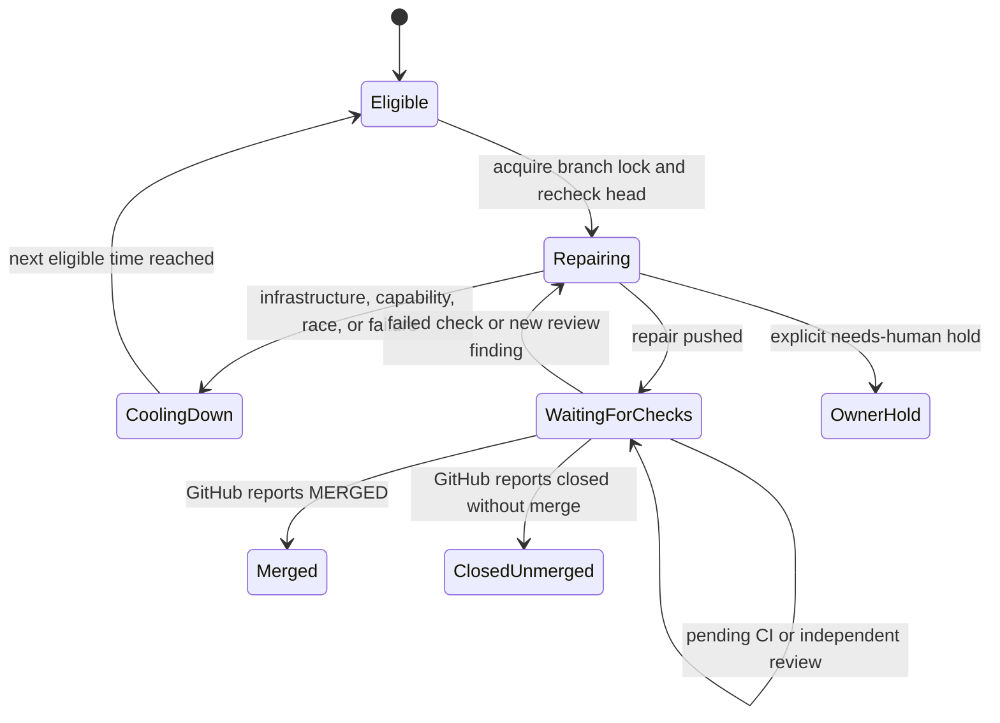

# Fleet PR babysitter MVP

The babysitter scans the repositories in `.config.json` for open fleet PRs with
merge conflicts, outdated branches, failed CI or requested review changes. By
default it fixes candidates. It takes the same PR branch lock as the fleet's CI
and conflict workers, rechecks the head, and runs one Codex session in a
temporary clone. Up to two independent PR repairs run at once, each with a
90-minute Codex limit and its own branch lock. While repairs run, it rescans
every five minutes and queues newly actionable PRs without starting two repairs
for the same PR. Before Codex starts, the babysitter merges the PR's latest base
into the temporary clone without committing, for every kind of repair, so the
agent works and runs its checks against up-to-date code and the fix and the
branch update reach GitHub in **one push**. A second push just to update the
branch would run the whole CI again and roughly double the Actions cost of the
repair. After Codex reports a completed fix, the babysitter commits the fix and
the merge together as one merge commit, checks the fix (not the base's own
changes) for whitespace errors and conflict markers, and rechecks the PR. It
pushes only if the PR still matches the original head. A base merge on its own
is also pushed when the agent made no change, so the branch is never left
behind. Once a review fix is pushed, the babysitter dismisses the addressed
review if it is still the current review and the PR head has not changed. GitHub
CI then runs the repository's quality and regression checks on the updated
branch.

The babysitter also arms auto-merge on every repair candidate that does not have
it yet, through the fleet's shared auto-merge helper, before any repair or
branch refresh. GitHub then merges the PR as soon as CI is green, the branch is
current and the review is approved; arming never bypasses those gates, and on a
base without required checks the helper uses its gated direct merge instead of a
blind `--auto`. Merging soon after the gates pass leaves less time for the base
to move on and cause conflicts. A failure to arm is logged as a WARNING and does
not stop the repair.

The shared repository list stays unchanged. The babysitter monitors only the
configured repositories accessible to its selected GitHub App installation and
logs each skipped repository. For example, an App installed only on
`stSoftwareAU` skips private `TitlePage` repositories in the same configuration.
Access is rediscovered at the start of each pass, including in `--watch` mode;
write tokens are scoped to the accessible configured subset. An explicitly
requested inaccessible `--repo` fails, as do discovery errors or an empty
accessible subset. Access changes during a pass remain API errors and are
re-evaluated on the next pass.

From the VibeCoder checkout:

```sh
# Interactive setup and preflight. It asks whether to install a launch agent;
# answer no until you have manually tested a fix.
./fleet-pr-babysitter/setup.sh

# Report candidates only; no model calls or PR changes.
./fleet-pr-babysitter/run.sh --dry-run

# Fix candidates in one pass.
./fleet-pr-babysitter/run.sh

# Limit a first execution to one monitored PR.
./fleet-pr-babysitter/run.sh --repo=owner/name --pr=123

# Repeat every five minutes, after each pass finishes.
./fleet-pr-babysitter/run.sh --watch
```

Setup prompts for the GitHub App ID and private-key path, discovers the App
installation, and verifies its permissions, repository access and GraphQL quota
without printing credentials, then saves the App settings for run.sh and adds
its bot to this host's fleet-lock identities. It checks and required commands.
For a non-interactive preflight, use `--check` and `--app-id=<id>`; the key
defaults to `~/.vibe-coder/fleet-pr-babysitter.private-key.pem`, or pass
`--key=<path>`.

On the always-on Mac, rerun setup after manual testing and answer yes to the
launch-agent question. You must also type `INSTALL` to confirm. Setup checks
that the App bot is a configured fleet identity, creates a new launchd job and
starts it; it refuses to overwrite an existing job. Every fleet host must trust
the App's branch locks. To stop the agent, use the `launchctl bootout` command
printed by setup. Launchd starts one pass every five minutes and starts another
after a process failure.

Manual and launchd runs keep their output under
`~/.vibe-coder/fleet-pr-babysitter/logs`. Each completed pass is compressed; the
newest 30 compressed logs are retained, with each pass limited to 10 MiB before
compression. These logs may contain model output and are private to the host
user; do not publish them. If a process is interrupted or compression fails, its
uncompressed log remains available for diagnosis and the next pass retries
compression after confirming that its owner has exited. Each pass also removes
its temporary PR clones after use. A later pass removes clones left by an
interrupted babysitter after confirming their owner exited; it leaves live and
unrelated directories alone.

Each repository also has one bare mirror, kept at
`${XDG_STATE_HOME:-$HOME/.local/state}/vibe-coder/fleet-pr-babysitter/mirrors/<owner>--<repo>.git`.
The first repair of a repository downloads it once with `git clone --bare`,
bounded to 30 minutes. The download is built in a `.tmp` sibling and renamed
into place only when complete, so a failed download leaves no mirror. Each later
repair fetches heads and tags with `--no-auto-maintenance` in the mirror, then
runs automatic maintenance in the foreground before copying, serialised per
repository within the process. It then runs
`git clone --no-checkout --no-hardlinks <mirror> <dir>` to make its temporary
clone. That clone holds the full history, so merge bases and `git diff` against
the base work without lazy fetches; it is not a partial clone and does not
depend on the mirror afterwards. The clone's `origin` is then set back to the
GitHub URL: `git@github.com:<repo>.git` when
`gh config get git_protocol -h github.com` reports `ssh`, otherwise HTTPS. Each
fetch uses the currently resolved URL, even if the mirror was created with a
different protocol. If the fetch fails, the repair fails with git's cause, the
mirror is kept, and the next pass retries. Passes never remove mirrors; delete a
mirror directory to force a fresh download. Codex reads the filesystem under its
permissions profile, so it can read a mirror, but it cannot write to one because
its write grants are only the clone and scratch directory. Mirrors are not among
the `~/.vibe-coder/fleet-pr-babysitter*` denylist entries, so do not treat them
as credential-protected.

An optional executable `~/.vibe-coder/fleet-pr-babysitter/health-hook` receives
the pass exit code as its sole argument. It is bounded to ten minutes; hook
failure is logged and the next pass retries. Organisation-specific extensions
can use this to publish a separate babysitter heartbeat and failure record. Dry
runs and runs limited to a repository or PR do not report service health.

The host needs `gh`, `git` and `deno`. Codex CLI must be 0.164.0 or newer,
because older versions may silently ignore the permissions profile; a
pre-release counts when its base version is newer (0.166.0-alpha passes,
0.164.0-beta does not). Setup and each repair check the `codex` on PATH before
minting an agent token. When it is missing, too old or unrecognised, they
install the Codex version pinned in `container/tools.json` (CLI and code-mode
host, macOS or Linux, each archive verified against its pinned SHA-256) under
`~/.vibe-coder/codex/<version>-<target>/` and run that instead, so an unattended
host needs no manual upgrade. When RTK is available, each repair receives
instructions to use it; otherwise the babysitter logs a warning and continues
without it. Before execution, put the App's `<slug>[bot]` login in
`service_accounts` or `fleet_pr_authors` **on every fleet host**. Run setup on
each host (or deploy your organisation's fleet configuration) before starting
repairs. Those workers only trust locks written by known fleet accounts. The MVP
checks the local configuration; it cannot verify other hosts. Use a dedicated
account with only the access it needs. An operator may also configure a trusted
Codex RTK hook on each host. Each repair activates the worker-side GitHub write
allowlist for its target repository, including lock comments, branch updates and
review dismissals. Concurrent repairs use separate scopes. Codex runs with
approvals disabled, under a per-spawn Codex permissions profile
(`default_permissions` and a `permissions.<profile>.filesystem` inline table
passed as one `-c` value) that reads the filesystem, writes only the temporary
clone (its `.git` read-only) and scratch directory, and has no access (`none`)
to the babysitter App private key, the worker credential directory, the host
`gh` config directory, configured reviewer and worker App keys, configured
service-account SSH key, the `~/.vibe-coder/fleet-pr-babysitter*` entries and
their resolved symlink targets. Credential locations are read from the same
`CONFIG_PATH` file and host environment as the worker, including the documented
defaults `~/.vibe-coder/credentials` and `~/.config/gh`. The configured spelling
is resolved with filesystem traversal semantics, so `..` after a directory
symlink follows the target's parent. Normalised locations and their canonical
targets are also denied; missing tails are resolved through the longest existing
parent. These entries are denied because the agent shares the runner's
OS user and file modes alone do not protect them; it is also told not to ask
questions. When a fix
needs a human decision, it should report the blocker and stop without a commit.
The sandbox still applies; an unavailable permission or credential can stop a
run and must be corrected by the operator. Codex gets its own installation
token, minted per repair for the target repository only, with read-only
permissions (contents, pull requests, issues, checks, actions). Every GitHub
write (lock, push, branch update, review dismissal, PR description) is made by
the runner with its own token. The agent's read-only token expiry is retained,
and each Codex session ends two minutes before it. If a session reaches that
boundary, the runner starts a new session with a freshly minted, repository-
scoped read token in the same repair clone; the runner's write token and App
key remain outside the agent boundary. When a review asks for a
description change, the agent writes the full new description to
`.babysitter-pr-body` in the clone; the runner removes it before committing and
applies it after the push (or when there is no code change), re-adding any
closing reference such as `Closes #N` the proposal dropped.

The profile explicitly enables network access so the agent can fetch GitHub
feedback and check details. Host `[sandbox_workspace_write]` settings do not
apply to this profile: `network_access` and `writable_roots` are not inherited,
and `/tmp` is not automatically writable. The agent can write to its assigned
clone and scratch directory instead.

**Verifying the credential boundary.** The permissions-profile keys were written
without an installed Codex to test against. The paths are passed as the keys of
one inline-table value, not as dotted `-c` keys, because Codex splits a `-c` key
on every dot and every protected path contains dots. After upgrading Codex or
changing the key path, confirm on the host that the agent cannot read the key:
run a one-off `codex exec` with the same `-c` overrides the babysitter passes
(built by `buildBabysitterSandboxArgs` in
`worker/deno/lib/fleet_babysitter_sandbox.ts`), ask it to `cat` the App private
key, and expect a denied read. The GitHub token handed to the agent stays
read-only. This is a path denylist derived from the worker configuration and
documented host defaults, not a guarantee that every credential on a host is
unreadable.

Fleet-wide scans consider only fleet-authored, non-draft, same-repository PRs. A
PR labelled `needs-human` is never a candidate: it waits on a person, for
example a check that declared a human gate. An explicitly selected `--repo`
scans that repository regardless of PR author; `--pr` narrows the scan to one
PR. Both retain the same lock and validation. A red check whose workflow runs
were cancelled rather than failed (every run on the head finished, one or more
cancelled, none failed) starts no agent: the runner asks GitHub to re-run the
cancelled runs, once per head. That needs the App's `actions: write` permission;
with `actions: read` the re-run is refused and logged as a WARNING naming the
permission. A PR that a fleet worker holds a live PR-feedback lease claim on
(`PR_COMMENT_CLAIM` with an unexpired `PR_COMMENT_CLAIM_LEASE`) is skipped for
that pass, so the babysitter never repairs beside a worker that is about to
push.

Retry records live under
`${XDG_STATE_HOME:-$HOME/.local/state}/vibe-coder/fleet-pr-babysitter` as
versioned, atomically replaced JSON. Each record binds the repository, PR,
stable failure identity, observed and pushed heads, blocker class, last outcome,
infrastructure and substantive attempt counts, next eligible time, next action,
and reconciliation state. The identity survives repair pushes; a new change
request review gets a separate identity. A legacy create-only attempt file is
migrated to a five-minute cooldown and then becomes eligible again. No manual
state-file deletion is part of normal recovery.

Completed repair attempts carry a separate
`vibe-babysitter-attempt` marker in a fleet-authored PR comment. Hosts count only
markers written by configured fleet authors, so the configured repair limit
is shared across hosts and survives a restart. Only consecutive no-change or
failed outcomes count; a successful push resets the no-progress budget.
Infrastructure and capability failures do not add an attempt marker. These
markers cannot be mistaken for a CI escalation that lifts a human hold.

A failure is classified from where it is raised: a structured cause (agent
killed by a signal or exit 137/143, a lock that could not be renewed, a head
that moved) first, and the error text only as a fallback. Infrastructure, host
capability (missing tool, full disk) and head or lock races receive bounded
cooldowns without spending the substantive repair budget and post no attempt
marker. Codex diagnostics classify provider, authentication, quota, rate-limit,
network and memory failures as infrastructure; an unreadable or empty
diagnostic on a non-zero exit is also infrastructure. A reported quota reset
or retry-after time delays the next attempt. Code failures, runner
session-budget exhaustion and no-progress
outcomes spend that budget. A changed head bypasses the old cooldown while
keeping the attempt history. The retry
record is saved before any best-effort marker write, and a failed marker write
never replaces the repair's real error.

When substantive attempts reach the configured `maxAutoFixAttempts` limit, the
record keeps the newest five redacted evidence lines, and the babysitter posts
an auto-fix cap marker for failed CI or a separate babysitter handoff marker
for other incidents. Further sessions for that incident stop until
the head or requested review changes, including green review-feedback and
merge-conflict incidents. A failed handoff is retried without another agent
session. The shared tally also bounds sessions on a different host. A moved
head retains the attempt history and receives a changed-diagnosis prompt with
fenced, redacted prior evidence.

A fleet-authored marker deduplicates the handoff across hosts and restarts.
The stall self-repair ladder consumes the CI cap for eligible blocking red-CI stalls and
skips its first trip. Green review-feedback and conflict lanes do not consume
that cap, and non-blocking red-CI incidents do not enter the ladder; their safety bound is the paused babysitter incident. No separate
escalation issue is created. The comment identifies the babysitter handoff, so
it does not claim ownership of a human `needs-human` label. Explicit human
holds stay paused until cleared. Waiting paths release the branch lock; the
next scan logs the cause, next action, and eligible time.

Local git validation, staging, commit and merge failures are code failures even
when the diagnostic contains transport words in file paths or source text.
Clone, fetch and push failures default to infrastructure after capability
checks. A push `[rejected]` is a race; `[remote rejected]`, a declined
pre-receive hook and GH0xx rule violations are code failures. Git disk-full
and spawn failures count as capability failures for
every operation. A pending-CI observation preserves an escalated incident's
handoff head until repair consumes the head change. Handoff markers use that
incident head, independent of any older successful push on a host.

After a successful push the state records the pushed head and waits for CI and
independent review. Each later scan observes the PR without taking a lock:
pending CI, a pending or dismissed review, a draft, a cross-repository PR, a
repository with `skip_auto_merge` and a `needs-human` hold are each recorded as
what the PR waits on. A green, approved, clean PR is recorded as
`handed-to-auto-merge-owner`: the shared auto-merge policy and worker sweep
handle landing it. The babysitter arms candidates through that shared policy
before repair, subject to its existing gates.
Failed checks and new requested changes return to the repair scan. A later scan
reads tracked PRs even when they are no longer in the first page of open
candidates, and clears retry state after GitHub reports `MERGED` or `CLOSED`.
A push, a hand-off or a dismissed review is never a merged outcome. Closed
records are not re-read on later scans; a reopened PR appears in the open list.



Repository mirrors live in the same state directory, under `mirrors/`, as
described above.

## Shift-left detection

A fleet PR that fails CI costs a CI run and a second agent session to repair it.
Each pass, before it starts repairs, the babysitter looks for CI failures that
keep recurring on fleet PRs and that a check on the Mac could have caught before
the PR was raised (Issue #4610). It does not weaken any check; it moves the same
check earlier.

- It reads the PR workflow runs that failed since its last scan and records one
  observation per failed job of a fleet PR. A job counts only when its failed
  step runs a recognised local tool (`cargo clippy`, `cargo fmt`,
  `cargo mutants`, `cargo llvm-cov`, `deno test`, `markdownlint` and so on) and
  the CI failure classifier calls it a code fault. Infrastructure, timing,
  aggregator and deployment-state failures never count.
- When the same check and step fail on 3 or more distinct fleet PRs within 7
  days, it files one issue in the repository that owns the fix:

  | Situation                                                                                                       | Filed in                           |
  | --------------------------------------------------------------------------------------------------------------- | ---------------------------------- |
  | Most failing heads were pushed by the babysitter itself                                                         | VibeCoder                          |
  | The repository's `quality.sh` already runs the tool, so the fleet raised or pushed without a passing local gate | VibeCoder                          |
  | CI runs the tool but no local gate does, in 2 or more repositories                                              | VibeCoder, once (a fleet-wide gap) |
  | CI runs the tool but this repository's local gate does not                                                      | That repository                    |

- A repository's VibeCoder-routed checks are filed as one issue that lists every
  tool, because they share one cause.
- Issues carry the `idle-task` label, so the fleet picks them up without a human
  label. A recurrence adds at most one comment a day to the open issue; a
  recurrence after the issue was closed files a new issue that links the old
  one. A VibeCoder issue about a private repository names neither the repository
  nor its PRs.
- Each pass inspects at most 40 failed runs per repository and remembers the
  runs it has scanned, so a busy repository's backlog does not delay repairs;
  later passes pick up the rest.
- The ledger is `shift-left-ledger.json` in the babysitter state directory. A
  dry run records observations and reports what it would file, but writes
  nothing to GitHub. A run limited with `--pr` skips detection.

Each repair also re-runs its checks locally before it reports ready: a CI repair
reproduces the failing step with the command the workflow runs and confirms it
passes, and review and conflict repairs run the formatter, linter and type or
compile check for the code they touched.

This MVP uses the configured GitHub App and Codex; it does not yet select
providers by remaining quota, handle Dependabot, use per-repository quality
commands, or review PRs. It does not change repository CI, review, or merge
rules. Test the read-only pass before running execution mode.

To prepare a separate GitHub identity and API quota, follow the
[babysitter GitHub App setup](fleet-pr-babysitter-github-app.md).
