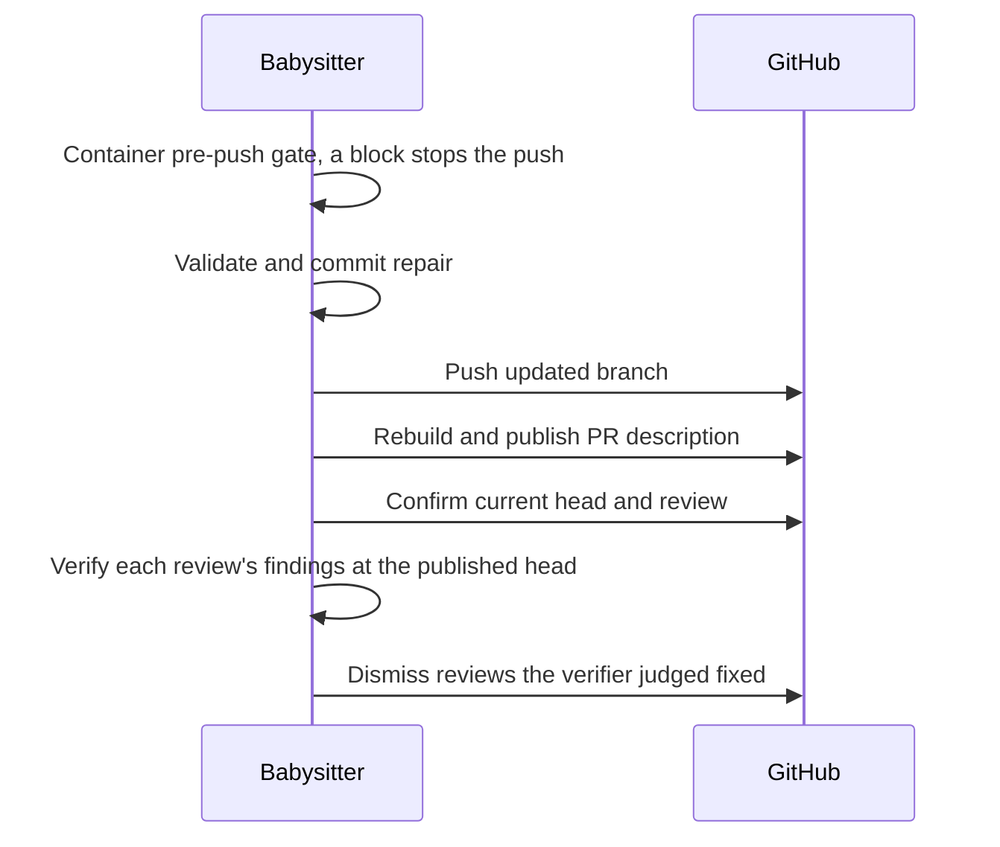
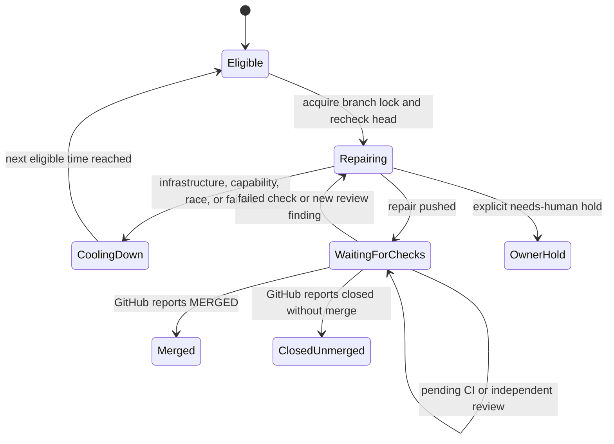

# Fleet PR babysitter MVP

The babysitter scans the repositories in `.config.json` for open fleet PRs with
merge conflicts, outdated branches, failed CI or requested review changes. By
default it fixes candidates. It takes the same PR branch lock as the fleet's CI
and conflict workers, rechecks the head, and runs one repair session in a
temporary clone, inside a worker container. One repair container runs at a time
(`BABYSITTER_REPAIR_CONTAINER_LIMIT`), with a 90-minute container limit and its
own branch lock: each repair container starts its own egress proxy, and two at
once cost about 31 GB of host disk and crossed the worker's floor (Issue #5105).
While a repair runs, it rescans every five minutes and queues newly
actionable PRs, which start when the running one ends, without starting two
repairs for the same PR. Before the repair session starts,
the babysitter merges the PR's latest base into the temporary clone without
committing, for every kind of repair, so the agent works and runs its checks
against up-to-date code and the fix and the branch update reach GitHub in **one
push**. A second push just to update the branch would run the whole CI again and
roughly double the Actions cost of the repair. In the container, a pre-push gate
runs over the agent's uncommitted changes before its completion line counts, and
a blocked gate means nothing is committed or pushed (see
[Container repairs](#container-repairs)). After the repair session reports a
completed fix, the babysitter commits the fix and the merge together as one
merge commit, checks the fix (not the base's own changes) for whitespace errors
and conflict markers, and rechecks the PR. It pushes only if the PR still
matches the original head; a review repair also pushes only if the PR's
requested reviews still carry the same findings. A newer change request on the
same head refuses the push as a race, spends no substantive attempt, and the
next scan repairs from the newest review (Issue #4968). A base merge on its own
is also pushed when the agent made no change, so the branch is never left
behind. After a push, the babysitter
synchronises the PR description from the summary committed at the pushed head,
then publishes any description the agent proposed (see below), and dismisses a
review only after an independent verifier judges every finding in it fixed at
the published PR head and description (Issue #4657). The review must also still
be the current review, and the PR head must not have changed. A retry with no
working-tree changes also synchronises the body before dismissal, so a prior
failed publication can be repaired. A failed body publication or a stale repair
checkout leaves the review open. A partial or missing verdict, or a head or
description that moves while the fixes are verified also leaves the review open,
without blocking the push. A verifier outage (the verifier failed, was not
checked, could not get its credential, or the head or description moved while
the fixes were verified) additionally keeps the pending-publication record. When
the pass pushed nothing, it also ends as an infrastructure failure with
infrastructure backoff, so the next scan re-runs only the publication and the
verification, never the agent, and no substantive attempt is spent. After a push
the outage ends no pass as a failure and sets no backoff: the kept record is
retried on the next scan. A pass that pushed nothing and left its reviews open
is journalled as a failed repair; a pass that pushed is not. Harmless skips,
such as an unrelated marker-less PR or an already-current description, do not
block dismissal. GitHub CI then runs the repository's quality and regression
checks on the updated branch.

When a repository keeps a per-PR summary that CI checks for freshness, the
repair prompt names the PR's own `docs/archive/pr-summaries/pr-summary-<N>.md`
from its `issue-<N>` head branch and tells the agent to rewrite it so every
claim, count and result matches the pushed head. Summaries brought in by the
base merge belong to the PRs that wrote them. When the head branch has no issue
number, the prompt gives the same ownership guidance without an example
filename. It must replace stale summary text rather than add a follow-up note
beside it (Issue #4755).



The babysitter also arms auto-merge on every repair candidate that does not have
it yet, through the fleet's shared auto-merge helper, before any repair or
branch refresh. GitHub then merges the PR as soon as CI is green, the branch is
current and the review is approved; arming never bypasses those gates, and on a
base without required checks the helper uses its gated direct merge instead of a
blind `--auto`. Merging soon after the gates pass leaves less time for the base
to move on and cause conflicts. A failure to arm is logged as a WARNING and does
not stop the repair.

The shared repository list stays unchanged. The babysitter monitors only the
configured repositories accessible to its selected GitHub App installation and
logs each skipped repository. For example, an App installed only on
`stSoftwareAU` skips private `TitlePage` repositories in the same configuration.
Access is rediscovered at the start of each pass, including in `--watch` mode;
write tokens are scoped to the accessible configured subset. An explicitly
requested inaccessible `--repo` fails, as do discovery errors or an empty
accessible subset. Access changes during a pass remain API errors and are
re-evaluated on the next pass.

From the VibeCoder checkout:

```sh
# Interactive setup and preflight. It asks whether to install a launch agent;
# answer no until you have manually tested a fix.
./fleet-pr-babysitter/setup.sh

# Report candidates only; no model calls or PR changes.
./fleet-pr-babysitter/run.sh --dry-run

# Fix candidates in one pass.
./fleet-pr-babysitter/run.sh

# Limit a first execution to one monitored PR.
./fleet-pr-babysitter/run.sh --repo=owner/name --pr=123

# Repeat every five minutes, after each pass finishes.
./fleet-pr-babysitter/run.sh --watch

# Run the image's headless Chromium launch check without App authentication.
./fleet-pr-babysitter/run.sh --check-container
```

Setup first checks the required commands, container runtime and image, then
launches headless Chromium inside that image; it does not install Codex. The
browser check passes only when the container command exits zero and stdout
contains `<html`. Setup stops with the cause if the runtime, image or browser
check fails. After those checks, setup prompts for the GitHub App ID and
private-key path, discovers the App installation, verifies its permissions,
repository access and GraphQL quota without printing credentials, then saves
the App settings for run.sh and adds its bot to this host's fleet-lock
identities.
For a non-interactive preflight, use `--check` and `--app-id=<id>`; the key
defaults to `~/.vibe-coder/fleet-pr-babysitter.private-key.pem`, or pass
`--key=<path>`.

Each automatic babysitter pass repeats the Chromium check before PR discovery
or GitHub App authentication. A failure is reported as a failed pass and the
existing supervisor or watch loop retries it. `--check-container` runs the
same bounded check on demand before reading App configuration or authenticating;
it prints the specific runtime, image, timeout, exit, output or host-disk
admission cause (`babysitter Chromium check not started: ...`) and exits
non-zero on failure. The check overrides the image entrypoint with `bash`, runs
`"$CHROMIUM_PATH" --headless --no-sandbox --dump-dom about:blank`, and accepts
only exit zero with HTML on stdout. It keeps the launch plan's network and
egress settings and removes host mounts from the short-lived probe container.
Diagnostic checks do not invoke the service-health hook, whether they succeed
or fail, because they do not run an authenticated babysitter pass.

On the always-on Mac, rerun setup after manual testing and answer yes to the
launch-agent question. You must also type `INSTALL` to confirm. Setup checks
that the App bot is a configured fleet identity, creates a new launchd job and
starts it; it refuses to overwrite an existing job. Every fleet host must trust
the App's branch locks. To stop the agent, use the `launchctl bootout` command
printed by setup. Launchd starts one pass every five minutes and starts another
after a process failure.

Manual and launchd runs keep their output under
`~/.vibe-coder/fleet-pr-babysitter/logs`. Each completed pass is compressed; the
newest 30 compressed logs are retained, with each pass limited to 10 MiB before
compression. These logs may contain model output and are private to the host
user; do not publish them. If a process is interrupted or compression fails, its
uncompressed log remains available for diagnosis and the next pass retries
compression after confirming that its owner has exited. Each pass also removes
its temporary PR clones after use. A later pass removes clones left by an
interrupted babysitter after confirming their owner exited; it leaves live and
unrelated directories alone.

Each repository also has one bare mirror, kept at
`${XDG_STATE_HOME:-$HOME/.local/state}/vibe-coder/fleet-pr-babysitter/mirrors/<owner>--<repo>.git`.
The first repair of a repository downloads it once with `git clone --bare`,
bounded to 30 minutes. The download is built in a `.tmp` sibling and renamed
into place only when complete, so a failed download leaves no mirror. Each later
repair fetches heads and tags with `--no-auto-maintenance` in the mirror, then
runs automatic maintenance in the foreground before copying, serialised per
repository within the process. It then runs
`git clone --no-checkout --no-hardlinks <mirror> <dir>` to make its temporary
clone. That clone holds the full history, so merge bases and `git diff` against
the base work without lazy fetches; it is not a partial clone and does not
depend on the mirror afterwards. The clone's `origin` is then set back to the
GitHub URL: `git@github.com:<repo>.git` when
`gh config get git_protocol -h github.com` reports `ssh`, otherwise HTTPS. Each
fetch uses the currently resolved URL, even if the mirror was created with a
different protocol. The clone's `info/exclude` also lists the tool byproducts
`*.profraw`, `*.profdata`, `lcov.info`, `/mutants.out/` and `/mutants.out.old/`,
so an untracked copy is never committed as part of a fix (Issue #4827). The
exclusion covers untracked paths only; a file the repository tracks is still
committed when a repair edits it. If the fetch fails, the repair fails with
git's cause, the mirror is kept, and the next pass retries. Passes never remove
mirrors; delete a mirror directory to force a fresh download. The repair
container does not mount the mirror. The agent can write only its clone and
scratch directory; it can read what "Credentials across the boundary" lists. Do
not treat mirrors as credential-protected. Every other git command a repair runs
through the babysitter's generic runner, including the tracking-ref fetches and
the push of the fix, is also bounded to 30 minutes rather than the 60-second
default for git.

An optional executable `~/.vibe-coder/fleet-pr-babysitter/health-hook` receives
the pass exit code as its sole argument. It is bounded to ten minutes; hook
failure is logged and the next pass retries. Organisation-specific extensions
can use this to publish a separate babysitter heartbeat and failure record. Dry
runs and runs limited to a repository or PR do not report service health.

The host needs `gh`, `git` and `deno`, the Claude CLI with a working Claude
credential for the review verifier (Issue #4657), and the container runtime that
the worker's launch plan selects (docker, podman or Apple `container`) with the
worker image built. The read-only verifier uses Claude only, regardless of the
configured agent provider or fallback; it refuses a fallback that cannot enforce
its isolation. Without them the verifier reports an outage and every review
stays open. A pass that pushed nothing is retried under infrastructure backoff;
after a push the kept publication record is retried on the next scan, with no
backoff. Setup runs the runtime/image preflight and Chromium launch check; it
does not install Codex. Before execution, put the App's `<slug>[bot]` login in
`service_accounts` or `fleet_pr_authors` **on every fleet host**. Run setup on
each host (or deploy your organisation's fleet configuration) before starting
repairs. Those workers only trust locks written by known fleet accounts. The MVP
checks the local configuration; it cannot verify other hosts. Use a dedicated
account with only the access it needs. Each repair activates the worker-side
GitHub write allowlist for its target repository, including lock comments,
branch updates and review dismissals. Each repair uses its own scope.
The repair session runs in a container, described under "Container repairs"
below. Its agent is told that it runs unattended and must not ask questions;
when a fix needs a human decision, it reports the blocker and stops without a
commit. Its repository token is minted per repair for the target repository
only, with read-only permissions (contents, pull requests, issues, checks,
actions). Every GitHub write (lock, push, branch update, review dismissal, PR
description) is made by the runner with its own token. The review verifier is a
Claude model that reads untrusted review text and repository code as the same OS
user, so it is confined separately: its own read-only token for the target
repository as `GH_TOKEN`, minted per verification, never the runner's write
token; no Bash, Edit, Write or NotebookEdit, so it can run nothing and write no
file; no Read of the protected paths (the babysitter App private key, the worker
credential directory, the host `gh` stores, the configured reviewer and worker
App keys, the configured service-account SSH key, the
`~/.vibe-coder/fleet-pr-babysitter*` entries and their resolved symlink targets)
or of `/proc`; and the Claude CLI starts without project or user settings
(`--setting-sources ""`) or ambient MCP servers (`--strict-mcp-config`), so a
hook or MCP entry committed in the PR's checkout cannot run a command outside
the tool rules. Because it has no shell, the worker hands it the evidence as
files outside the checkout: the `git diff base...head` and a read-only tree at
the base ref, and its prompt says the tools are unavailable. A check that needs
a command run (a test that must go red without the fix) is reported as not run,
so it is not judged fixed on a claim alone. If its token cannot be minted, the
pass is an outage. The protected paths are read from the same `CONFIG_PATH` file
and host environment as the worker, including the documented defaults
`~/.vibe-coder/credentials` and `~/.config/gh`. The configured spelling is
resolved with filesystem traversal semantics, so `..` after a directory symlink
follows the target's parent; normalised locations and their canonical targets
are denied, and missing tails are resolved through the longest existing parent.
When a review asks for a description change, the agent writes the complete new
description (Markdown) to `.babysitter-pr-body` in the clone. The proposal is
data, not authority. The runner takes the file out of the clone before the
change check, so it is never committed. After the push, or on a no-change retry
at the unchanged head, the description steps run in order:

1. It synchronises the description from the summary committed at the pushed
   head. The sync is pinned to that commit: just before the edit, the checkout
   must still be at it and `git ls-remote` must still report the PR branch at
   it. The pinned-head skips (`checkout moved off the committed head`,
   `pushed head moved`, `pushed head could not be verified`) keep the review
   open. So does any skip outside the harmless set: `no worker marker`,
   `summary unchanged`, `summary file deleted`, `body already current` and
   `summary not committed at the pushed head`.
2. After a push, it waits for GitHub's PR view to report the pushed head before
   the sync in step 1 runs. It reads the view up to ten times, one second apart
   (`waitForPushedHead`). If the view never shows that head, the step fails and
   the review stays open. Publishing then reads the live description and
   requires its head to equal the pushed head. The proposal is published on top
   of the sync, except on a repair that pushed nothing where a summary committed
   at the head governs the body: the sync already rebuilt the body from that
   summary, so the proposal is not published. The finish throws
   `ProposalOverGoverningSummaryError` and the reviews stay open. A description
   change on such a PR belongs in the committed summary, which a repair that
   pushes publishes. With no proposal, the body is edited only to withhold a
   close that GitHub still honours.
3. It strips every complete hidden `<!-- vibe-… -->` marker from the proposal in
   one linear scan. A marker quoted in a Markdown code span in the live body is
   not copied. A stray unclosed `<!--` in the proposal is neutralised, so it
   cannot hide the appended reference or markers. It then appends the live
   body's markers (worker issue, summary digest, sub-agent tier and assignment
   id), so the digest reconcile keeps working.
4. It decides closing or non-closing for the governing issue: the worker marker
   in the live body, else the issue the worker branch (`issue-N-...`) names, so
   a body that lost its marker is still governed. A PR with neither is unrelated
   and only gets its dropped closing references restored. Closing (`Closes #N`)
   is kept only when the summary committed at the pushed head has no `partial`
   or `missing` criterion and the proposal, if any, has no `partial` or
   `missing` criterion of its own. The summary's own wording does not decide it:
   for a fully met summary the guard appends `Closes #N` unless the proposal
   already has a closing keyword for the issue that GitHub would honour. The
   keyword counts only when it and `#N` (or this repository's `owner/repo#N`)
   are on one line, separated by spaces or tabs only, and outside Markdown
   code, and the colon form (`Closes: #N`) and full-URL form
   (`Closes https://github.com/o/r/issues/N`) count on the same terms. A keyword
   whose `#N` or URL is on the next line (hard-wrapped, including
   `Closes:\n#N`), split from it by a code span (``Closes `x` #N``), or quoted
   in code does not stop the append. An explicit non-closing reference still
   settles it as before. It differs from the canonical
   assembler on purpose: the assembler appends `Closes #N` whenever the summary
   has no closing keyword, even beside `Part of #N` or `Refs #N`, but the guard
   honours an explicit non-closing reference the agent chose, namely
   `Part of #N`, `Ref #N`, `Refs #N`, `Refs: #N`, `References #N`,
   `Related to #N` or `Relates to #N` (in this repository, or with no repository
   given). That can only leave the issue open, never close it, and a proposal is
   data and not authority to close, so that reference is not overridden with
   `Closes #N`. A bare mention such as "addresses the review on #N", or another
   repository's `owner/repo#N`, is not a closing claim and does not stop the
   append. The summary is read with the shared committed loader
   (`loadCommittedPrSummary`) at the verified pushed head sha, using
   `git ls-tree` and `git show`. The working tree is never read. The loader
   tries the same candidate paths as the sync, in order: the canonical
   `docs/archive/pr-summaries/pr-summary-<N>.md`, the legacy
   `docs/pr-summary-<N>.md`, then `.pr_summary`. A failed read leaves the review
   open. An unmet criterion, a missing committed summary or unknown evidence
   gives `Part of #N`. So does a negated sentence such as "does not close #N",
   which GitHub still honours as a closing reference, so that sentence is
   reworded. An association the proposal dropped entirely is restored in the
   form the evidence supports, and closing references to other issues that the
   proposal dropped are restored.
5. It verifies before dismissal. The live head is checked before the edit and
   again after it. When an edit was made, the description read back must match
   what was published. When the close is withheld, GitHub's
   `closingIssuesReferences` must not list the issue as closed by the PR; this
   check runs only in that case. The body reads must include
   `closingIssuesReferences` as an array: a missing key is rejected, not read as
   "no references". Dismissal then waits up to ten reads, one second apart, for
   the PR head to show the pushed head. Only the reviews that are still
   requested are dismissed, and only those the independent verifier judged fixed
   (Issue #4657). Every finding of a review must be judged fixed, by exactly one
   verdict for that review, at the head and description read after the
   publication. The verifier reads that published description and the agent's
   reply. An outage, a partial or missing verdict, or a head or description that
   moved during verification keeps the review open. The push still stands. An
   outage also keeps the pending-publication record, so the next scan
   re-verifies without running the agent.

A proposal over GitHub's 65,536-character limit is rejected at intake, once
surrounding whitespace is trimmed, and the review stays open. The composed
description is checked against the same limit again when it is published, after
the push and the sync. The limit applies to the whole description, including the
appended references and markers, so a proposal under the limit can still be
refused. A refusal leaves the review open.

Any failure leaves the review open, and a later eligible scan retries on the
pushed head, except a proposal refused over a governing summary (step 2), which
a retry would refuse again: its pending record is cleared and the review stays
open until the committed summary changes. A repair that addresses reviews writes
a pending-publication record, `<attempt key>--publication.json` in the same
state directory, before the sync. It holds the proposal and whether the repair
pushed the head. The next eligible scan finds the record before it merges the
base or starts the agent, and runs the publication again from a clean clone at
the PR head; the record is removed once the reviews are dismissed, or when the
proposal is refused over a governing summary. It is found only while the scan
still sees the same requested review at that head. The retry is idempotent: a
body that is already current is not edited again. A legacy body that has the
worker marker but no summary digest is synchronised through the before-push
diff. On a no-change retry there is no earlier head, so the diff runs against
git's empty tree: the committed summary counts as changed, and the sync still
edits only when the rebuilt body differs from the live one. The recoverable next
action is the thrown error, the open review and the pending-publication record;
when the proposal was refused over a governing summary the record is cleared, so
it is the error and the open review, and the fix is to change the committed
summary and push. The guard is `worker/deno/lib/babysitter_pr_body_guard.ts`,
and the close decision uses the close guard (#3177/#4644) in
`worker/deno/lib/missing_criterion_close_guard.ts`.

The runner and the agent exchange files through a runner-owned exchange
directory that the agent cannot write, outside the clone and scratch mounts. The
runner stages the PR description it applies there before
`gh pr edit --body-file`, and the agent writes its final response to
`.babysitter-response` in the clone. After the container exits, the host reads
that file through the no-follow, regular-file, size-bounded reader, removes it
from the clone, and hands it to the exchange directory, where the
`BABYSITTER_READY` completion check runs on the host. A blocked pre-push gate
removes that line before the container exits and puts a
`[BABYSITTER_GATE_BLOCKED]` line with the cause first in the response (see
[Container repairs](#container-repairs)). The agent can also write
`.babysitter-pr-body` in the clone, so the runner reads that file through the
same reader. A symlink, FIFO, hard link or oversized file fails the repair
before anything is published. The bounded reader opens read-write, so a FIFO
raced in before the open does not block on Unix; it then refuses the non-regular
descriptor. This also requires write permission on the output file. Another
special file can still leave an open pending after the timeout; it cannot be
cancelled and can keep a process alive. The non-watch pass explicitly exits
after cleanup so it cannot hold the supervisor. Watch mode continues running
with the pending open; if it eventually completes, its descriptor is closed. A
repair that fails this way publishes no PR description and dismisses no review.
It is recorded as a failed attempt under the durable retry policy below; no
manual state-file deletion is required. A repeated review ID alone is not new
repair input.

## Container repairs

Each repair runs in one container, started by `runBabysitterRepairContainer`
(`worker/deno/lib/fleet_babysitter_container.ts`). The clone is mounted at
`/babysitter/clone` and a scratch directory holding `prompt.md` is mounted at
`/babysitter/scratch`. The image runs the in-container `babysitter-repair`
command with `--dir /babysitter/clone`, `--prompt-file` pointing at the prompt,
and `--response-file /babysitter/clone/.babysitter-response`, with
`--base-branch refs/heads/<base>` carrying the PR's base branch for the gate's
baseline (the prefix keeps the argument parser from turning a branch named
`7.0` into the number 7). The agent's
read-only repository token is passed as `GH_TOKEN` by name only, so its value
never appears on a command line. The clone's `.git` is mounted read-only over
the read-write clone (`<clone>/.git` at `/babysitter/clone/.git:ro`, listed
after the clone mount), so the agent cannot write objects, refs or config that
the host's git later trusts, and the host stages the resolved files itself. The
working tree stays read-write. As defence in depth, before host publication,
`resetRepairCloneGitConfig` rewrites the clone's `.git/config` as a minimal
canonical GitHub remote config, dropping any local hooks, filters,
fsmonitor, external diff and SSH commands. The reset keeps `core.ignorecase` and
`core.precomposeunicode` by probing the clone's filesystem on the host (the
agent's config is not read), so a case-only rename is still seen as a rename on
a case-insensitive filesystem. Publication git runs with hooks and fsmonitor
disabled, submodule recursion off, submodule diffs ignored and replacement
objects ignored (`core.useReplaceRefs=false`); the host's `run()` git calls and
the review verifier's git calls in the clone use the same flags
(`HOST_GIT_HARDENING_ARGS`). Before those calls, the host refuses any nested
`.git` entry (matched case-insensitively, with git's `git~1` alias), any index
gitlink absent from both HEAD and the pending merge parent, any `refs/replace`
ref, and a `.git/info/grafts` or
`.git/shallow` file. Checked-out existing submodules are also refused; the
staged merge is preserved.

**Pre-push gate.** Once the agent's final message ends with the
`BABYSITTER_READY` line, the container runs the repository's pre-push gate over
the agent's uncommitted working-tree changes, before the host reads the
response. A response without that line, or an agent that changed nothing, runs
no check. The gate runs the unit tests selected for the changed files
(`deno task test:unit` for a Deno root that defines that task, with the same
selection as the worker's other repair pushes; a change to a prompt, `deno.json`
or `deno.lock` runs the whole suite), markdownlint when configured, the
ShellCheck policy and the cargo-deny gate. When those pass it runs the gitleaks
secret scan (Issue #5121, `runGitleaksTreeCheck` in `gitleaks_check.ts`): the
branch's commit range, `<merge-base with origin/<base branch>>..HEAD`, which is
the range the blocking `gitleaks / gitleaks` CI check scans, and each changed
file as it now is on disk, because the host commits and pushes those edits
next. The repair does not go through `./quality.sh`, whose gitleaks stage scans
commits only. A finding blocks and spends a repair attempt, with the rule, path
and line and the secret redacted. A missing `gitleaks`, a diff base that cannot
be resolved, a scanner error or a scan past its 300s deadline is an
infrastructure fault and spends none. The gate does not run the formatters or
linters. When the repair has merged the PR's base without committing, the gate
checks only the paths whose working-tree content differs from the merged base
commit, or that are untracked, so a file the merge merely brings in is the
base's and is neither checked nor compared. The baseline is then the merged base
commit (the gate names it beside the head, so the merge-base is the base tip),
not the PR's old fork point. A failing unit test that also fails the same way at
the merge-base with the PR base is a warning, as in the other repair pushes.
Without `--base-branch`, which the host passes from the PR's base branch, the
gate has no baseline and a failing test blocks. Unit-test discovery also blocks
when it cannot read or parse a Deno config or its task definitions, naming that
config and reporting that unit tests were not checked. It does not drop the
root's tests or fall through from an unreadable `deno.json` to `deno.jsonc`.
A missing primary config may still use `deno.jsonc`; valid configs without
`test:unit` remain ineligible. A config refusal is a code failure that withholds
READY and spends a repair attempt, rather than an infrastructure retry.
A check that cannot run is never a pass, and
the kind of failure decides what it costs. A module-fetch outage, a missing
ShellCheck, a missing or unusable cargo toolchain and a missing gitleaks are
infrastructure faults:
no repair attempt is spent and the repair is retried after a backoff. A
markdownlint binary that is not found blocks like a failed check, so it spends
an attempt. A dirty file the gate cannot compare also blocks: one over the
64 MiB limit, one whose parent directory leads out of the clone, or one it
cannot read at all (no permission, a looping symlink). A status
path that is a directory (a submodule pointer or a nested repository), is
missing, or sits under a file where a directory was is recorded by its kind, not
refused. The
container's `.git` is mounted read-only, so the baseline is not a git worktree
of the clone: it is a fresh repository in a temporary directory under the
container's temp dir that borrows the clone's objects (`objects/info/alternates`
and the clone's `shallow` file), with the base commit checked out detached and
hooks off. It is a real git checkout, so a test that inspects its checkout (for
example with `git ls-files`) behaves as it does on the base, and a failure that
only a checkout without `.git` would cause is never taken for the base's. If a check blocks or cannot run, the container removes the
`BABYSITTER_READY` line and puts a `[BABYSITTER_GATE_BLOCKED]` line with the
cause first in the response. The host's completion check then refuses to push
and quotes the cause; nothing is pushed. A failed check
(`pre-push checks failed`) is a code failure that spends a repair attempt
("agent did not report that its fix was ready"). A gate that could not run
(`pre-push checks could not run`, for example a module-fetch outage) is raised as
an infrastructure failure: it backs off and retries, and spends no repair
attempt. Only the gate writes the `[BABYSITTER_GATE_BLOCKED]` text: the
in-container command replaces it in the agent's own reply on every path, so an
agent that fails without `BABYSITTER_READY` cannot pass its failure off as an
infrastructure outage.

The Container Build containment suite also exercises this gate with disposable
repositories and the image's real Deno and markdownlint. It uses the repair
launcher's clone and read-only `.git` mounts and sanitised worker snapshot,
replacing the launched process with a probe that injects the agent services
while retaining the production repair command and check runners. The probe
runs as the fixture owner's UID/GID, matching the workflow's other in-image
checks. Deno assertion failures, Markdown errors and malformed Deno config must
withhold READY and stop the host publication harness; corrected controls and
an identical base-only test failure must reach publication. The harness fakes
GitHub and git publication, so it publishes no live PR. With
`VIBE_CONTAINMENT_REQUIRED=1`, the existing suite fails if a supported runtime
or image is unavailable; an ordinary local run reports that integration test
as skipped. See `worker/deno/tests/container_containment_test.ts` and its
`support/babysitter_gate_container_probe.ts` fixture.

A repair session's container timeout is the lesser of the remaining 90-minute
budget and the read token's expiry minus two minutes. On timeout the container
is killed; see "Token restarts" below. Egress follows the worker's egress
controls (Issue #4769). A runtime that enforces egress (docker or podman) gets
an internal network and proxy from the egress sidecar. Apple `container`, which
does not enforce egress, gets its run arguments from the Apple egress helper,
which may run in an advisory mode where host and LAN isolation is not promised.
A failed egress start fails the repair; the runtime's open network is never used
instead.

The worker image provides Chromium at `$CHROMIUM_PATH` for browser checks.

**Host-disk admission (Issue #5105).** Before any egress proxy or container
starts, the repair is admitted against the host's free disk, with the same floor
and the same reservation ledger (`host-disk-reservations/` in the host log
directory) the worker uses. The request is 16 GB (the worker container's
rootfs plus its egress proxy's), plus the worker's 25 GB ephemeral cargo
headroom when the clone holds a cargo project. A repair that would leave the
host below its floor, counting what live reservations have yet to consume, is
refused. A refusal is an infrastructure failure: it backs off and retries, and
spends an infrastructure attempt, not a substantive repair attempt. The
reservation is removed after the container and its proxy are torn down. A host
whose disk cannot be measured admits the repair without a reservation. The
Chromium launch check starts the same image and, on the Apple runtime, its own
egress proxy, so it is admitted the same way before any egress starts, for the
16 GB footprint alone (it builds nothing). A refusal is reported as a failed
pass, which the supervisor or watch loop retries, and the reservation is removed
after its container and proxy are torn down.

**Token restarts.** When a session ends at its read token's expiry, the host
deletes the response file, mints a fresh repository-scoped read token and starts
the container again. The clone is preserved. The restart prompt tells the agent
to continue from the current working tree and not to repeat completed steps. A
restart is attempted only while more than two minutes of the 90-minute budget
remain; otherwise the failure is final.

**RTK.** The host probe `rtk --version` decides whether the prompt carries the
RTK instruction. When the probe finds `rtk` and the image has `rtk` installed
(`container/tools.json`), the prompt tells the agent to prefix its shell
commands with `rtk`. When the probe does not find it, the prompt carries no RTK
instruction and the babysitter logs that the repair runs without RTK.

## Provider selection

`babysitter-repair` calls `chooseBabysitterProvider`
(`worker/deno/lib/babysitter_provider_choice.ts`), which applies this rule:

- A pinned provider runs that provider and never overflows. A pin is a
  non-automatic `agent_provider_mode`, or a `VIBE_AGENT_PROVIDER` value. In
  automatic mode a `VIBE_AGENT_PROVIDER` pin must name a provider in the enabled
  `agent_providers` set, or the repair fails.
- Before choosing, `babysitter-repair` exports the enabled subscription
  providers' logins (Claude, Codex) from the mounted credential directory, the
  same way the worker loop and reviewer rounds do (Issue #5072). DeepSeek's
  credential is not exported here; only the overflow choice exports it, into an
  isolated environment.
- In automatic mode the worker's subscription ranking chooses first. If routing
  finds a winner, that subscription runs the repair.
- DeepSeek is the last resort. If every subscription reads `billing-unknown`,
  meaning its login was never loaded, nothing is known about its quota. The
  chooser then refuses overflow with `refusing paid DeepSeek overflow: no
  subscription credential is loaded`, and the repair fails as a host capability
  fault instead of spending money.
- Only when routing pauses because no subscription has budget does the repair
  use DeepSeek as paid overflow. The chooser logs
  `[quota] babysitter paid overflow
  selected=deepseek`, with each ranked
  provider, credential label and exclusion reason, and it needs a DeepSeek
  credential that can be exported. Without one the repair fails; it does not
  wait or run on the host.

## Credentials across the boundary

The repair container receives:

- the agent's read-only repository token, as `GH_TOKEN`, minted again on each
  token restart;
- the clone and the scratch directory (prompt file), read-write, with the
  clone's `.git` mounted read-only over the clone;
- a tracked-files copy of the worker checkout, written on the host to
  `<scratch>/workspace` (regular tracked files only; ignored files are excluded,
  and its `.config.json` is a scrubbed copy), mounted read-only at `/workspace`.
  That copy sits inside the read-write scratch directory, so the agent can also
  reach the same files read-write at `/babysitter/scratch/workspace`;
- the repair scratch directory at the container log path, so logs do not expose
  the host's log directory;
- plan mounts whose source contains `/credentials/`: each enabled provider's
  credential sub-directory, with the launcher's read-only mode (the `gh` store
  is dropped);
- the plan's other `--env` specs (listed in the C36 row of
  `docs/THREAT-MODEL.md`), plus the short-lived `GH_TOKEN`. The host runtime
  allowlist (`BASE_ENV_ALLOWLIST`) goes to the runtime process, not into the
  container. Declared `quality_credentials` configuration is retained, and the
  existing quality command transport remains responsible for resolving and
  delivering its declared values.

The plan's named work and agent-state volumes are not mounted. The host `gh`
credential directory (the `gh` sub-directory of the Vibe credential directory)
is not mounted, and the host `gh` configuration (`~/.config/gh`) is not in the
plan's mount list. The operator's custom prompt directories
(`custom_label_prompts`) are not mounted, and the plan's
`VIBE_CUSTOM_PROMPT_PATHS` environment variable is dropped. The container does
not receive the babysitter App private key: the host checkout snapshot copies
tracked paths only, secret-bearing config keys are removed from the config
snapshot, and the final run arguments are checked against the App key path
(`assertBabysitterKeyOutOfRunArgs`). Unknown plan mounts fail closed. The host
keeps the App key, branch locks, attempt record, trusted commit/push, PR-body
publication and review dismissal. As defence in depth (the clone's `.git` is
read-only to the agent), before host publication the local clone config is
replaced with a minimal GitHub remote config using the configured protocol;
this would drop any hooks, filters, fsmonitor, `diff.external` or
`core.sshCommand` settings found in it.

## Failure behaviour

There is no host fallback. A missing container runtime, a missing image, an
egress failure or a non-zero container exit throws with its cause, and the pass
is recorded as failed. The messages are
`cannot run <runtime>: the container
runtime is not on PATH`,
`the worker image is not built; start the Vibe Coder
(./run.sh) once to build it`,
`egress setup failed: <cause>`, and
`babysitter
repair container <name> exited with code <N>` followed by the
redacted stderr and, because the image may predate the babysitter-repair mode, a
hint to relaunch with `./run.sh` to rebuild it. A timeout reports
`babysitter repair timed out after <N> minutes; container
<name> killed`, where
`<N>` is that session's own timeout, and a timeout that is not restarted (see
"Token restarts") fails the repair. A timeout is classified as infrastructure,
unless the 90-minute session budget has run out: the repair loop then raises
`agent session budget exhausted: <cause>` as a code failure. Missing runtime or
image is classified as a capability failure. Exit status 42, the in-container
task-failure status, is recorded as a substantive code failure; other launcher
failures, including egress failures and ordinary non-zero exits, are
infrastructure failures and use the default infrastructure backoff. The host
does not infer a failure category from agent-controlled stderr. A quota reset or
retry-after time is no longer read from the container's stderr; the Codex stderr
parsing is removed from the babysitter path. Richer retry handling stays with
the retry-state work tracked in #4656, which is closed; this change does not add
it.

## Scans, retries and failure classification

Fleet-wide scans consider only fleet-authored, non-draft, same-repository PRs. A
PR labelled `needs-human` is never a candidate: it waits on a person, for
example a check that declared a human gate. An explicitly selected `--repo`
scans that repository regardless of PR author; `--pr` narrows the scan to one
PR. Both retain the same lock and validation. A red check whose workflow runs
were cancelled rather than failed (every run on the head finished, one or more
cancelled, none failed) starts no agent: the runner asks GitHub to re-run the
cancelled runs, once per head. That needs the App's `actions: write` permission;
with `actions: read` the re-run is refused and logged as a WARNING naming the
permission. A PR that a fleet worker holds a live PR-feedback lease claim on
(`PR_COMMENT_CLAIM` with an unexpired `PR_COMMENT_CLAIM_LEASE`) is skipped for
that pass, so the babysitter never repairs beside a worker that is about to
push.

A failed-CI PR whose every failing check run is already red on its base branch
for the same failure starts no agent and charges no attempt (Issue #4921). The
runner compares each failing check with the base's run of that check, by check
identity and failure lines, using the comparison CI-fix uses
(`worker/deno/lib/ci_base_failure_signature.ts`); the decision is made in
`worker/deno/lib/babysitter_base_failure.ts`. It logs
`deferred (every failing check is already red on <base>: …)` and the PR is read
again on the next pass, when the base's fix has landed through the ordinary base
merge. A dependency-audit check, a failing commit status, a green, missing,
stale or unreadable base run, a base log showing a different failure, or any
unreadable evidence repairs as before. The repair prompt also tells the agent
not to repair a failure in a check unrelated to the files it changed, whether
that check passes or fails on the base: it names the failure and leaves it to
the base's fix.

Retry records live under
`${XDG_STATE_HOME:-$HOME/.local/state}/vibe-coder/fleet-pr-babysitter` as
versioned, atomically replaced JSON. Each record binds the repository, PR,
stable failure identity, observed and pushed heads, blocker class, last outcome,
infrastructure and substantive attempt counts, next eligible time, next action,
and reconciliation state. The identity survives repair pushes and repeated
reviews of the same problem/Fix pairs. Review IDs, verdict commentary and the
fleet review footer do not renew the budget; changed findings do. Reviews
without a readable body retain the per-review fallback because their inline
feedback cannot be fingerprinted. The `findings-v1` identity starts a new
incident once on upgrade; old retry records remain readable. A legacy
create-only attempt file is
migrated to a five-minute cooldown and then becomes eligible again. No manual
state-file deletion is part of normal recovery.

Completed repair attempts carry a separate `vibe-babysitter-attempt` marker in a
fleet-authored PR comment. Hosts count only markers written by configured fleet
authors, so the configured repair limit is shared across hosts and survives a
restart. Only consecutive no-change or failed outcomes count; a successful push
resets the no-progress budget. Infrastructure and capability failures do not add
an attempt marker. These markers cannot be mistaken for a CI escalation that
lifts a human hold.

A failure is classified from where it is raised: a structured cause (agent
killed by a signal or exit 137/143, a lock that could not be renewed, a head
that moved) first, and the error text only as a fallback. Infrastructure, host
capability (missing tool, full disk) and head, review or lock races receive
bounded cooldowns without spending the substantive repair budget and post no
attempt marker. A diagnostic that names a timeout, network, DNS or rate-limit
failure is classified as infrastructure. Container failures follow "Failure
behaviour":
exit status 42 is a code failure that spends that budget; exit status 43 means a
provider's quota, credit or balance is spent. That is a normal park
(`BabysitterParked`): infrastructure cooldown, one `Babysitter repair parked:`
log line, and it never joins the pass's `AggregateError` (Issue #5072). A
timeout is
infrastructure unless the 90-minute session budget has run out, which makes it
`agent session budget exhausted` (code); other launcher failures are
infrastructure and do not spend it. Code failures, runner session-budget
exhaustion and no-progress outcomes spend that budget. A changed head bypasses
the old cooldown while keeping the attempt history. The retry record is saved
before any best-effort marker write, and a failed marker write never replaces
the repair's real error.

When substantive attempts reach the configured `maxAutoFixAttempts` limit, the
record keeps the newest five redacted evidence lines, and the babysitter posts
an auto-fix cap marker for failed CI or a separate babysitter handoff marker
for other incidents. Further sessions for that incident stop until
the head or requested findings change, including green review-feedback and
merge-conflict incidents. A failed handoff is retried without another agent
session. The shared tally also bounds sessions on a different host. A moved
head retains the attempt history and receives a changed-diagnosis prompt with
fenced, redacted prior evidence.

A fleet-authored marker deduplicates the handoff across hosts and restarts. The
stall self-repair ladder consumes the CI cap for eligible blocking red-CI stalls
and skips its first trip. Green review-feedback and conflict lanes do not
consume that cap, and non-blocking red-CI incidents do not enter the ladder;
their safety bound is the paused babysitter incident. No separate escalation
issue is created. The comment identifies the babysitter handoff, so it does not
claim ownership of a human `needs-human` label. Explicit human holds stay paused
until cleared. Waiting paths release the branch lock; the next scan logs the
cause, next action, and eligible time.

A missing ready marker retains up to 2,000 characters of the redacted agent
reply in the failure, labelled as untrusted evidence. A gate block is a missing
ready marker too, and its `[BABYSITTER_GATE_BLOCKED]` line with the cause is the
first line of that reply. It cannot classify its
own failure, authorise a push or dismiss a review. The existing bounded
evidence ledger carries the cause into the next diagnosis.

Local git validation, staging, commit and merge failures are code failures even
when the diagnostic contains transport words in file paths or source text.
Clone, fetch and push failures default to infrastructure after capability
checks. A push `[rejected]` is a race; `[remote rejected]`, a declined
pre-receive hook and GH0xx rule violations are code failures. Git disk-full and
spawn failures count as capability failures for every operation. A pending-CI
observation preserves an escalated incident's handoff head until repair consumes
the head change. Handoff markers use that incident head, independent of any
older successful push on a host.

After a successful push the state records the pushed head and waits for CI and
independent review. Each later scan observes the PR without taking a lock:
pending CI, a pending or dismissed review, a draft, a cross-repository PR, a
repository with `skip_auto_merge` and a `needs-human` hold are each recorded as
what the PR waits on. A green, approved, clean PR is recorded as
`handed-to-auto-merge-owner`: the shared auto-merge policy and worker sweep
handle landing it. The babysitter arms candidates through that shared policy
before repair, subject to its existing gates. Failed checks and new requested
changes return to the repair scan. A later scan reads tracked PRs even when they
are no longer in the first page of open candidates, and clears retry state after
GitHub reports `MERGED` or `CLOSED`. A push, a hand-off or a dismissed review is
never a merged outcome. Closed records are not re-read on later scans; a
reopened PR appears in the open list.



Repository mirrors live in the same state directory, under `mirrors/`, as
described above.

## Shift-left detection

A fleet PR that fails CI costs a CI run and a second agent session to repair it.
Each pass, before it starts repairs, the babysitter looks for CI failures that
keep recurring on fleet PRs and that a check on the Mac could have caught before
the PR was raised (Issue #4610). It does not weaken any check; it moves the same
check earlier.

- It reads the PR workflow runs that failed since its last scan and records one
  observation per failed job of a fleet PR. A job counts only when its failed
  step runs a recognised local tool (`cargo clippy`, `cargo fmt`,
  `cargo mutants`, `cargo llvm-cov`, `deno test`, `markdownlint` and so on) and
  the CI failure classifier calls it a code fault. Infrastructure, timing,
  aggregator and deployment-state failures never count.
- When the same check and step fail on 3 or more distinct fleet PRs within 7
  days, it files one issue in the repository that owns the fix:

  | Situation                                                                                                       | Filed in                           |
  | --------------------------------------------------------------------------------------------------------------- | ---------------------------------- |
  | Most failing heads were pushed by the babysitter itself                                                         | VibeCoder                          |
  | The repository's `quality.sh` already runs the tool, so the fleet raised or pushed without a passing local gate | VibeCoder                          |
  | CI runs the tool but no local gate does, in 2 or more repositories                                              | VibeCoder, once (a fleet-wide gap) |
  | CI runs the tool but this repository's local gate does not                                                      | That repository                    |

- A repository's VibeCoder-routed checks are filed as one issue that lists every
  tool, because they share one cause.
- Issues carry the `idle-task` label, so the fleet picks them up without a human
  label. A recurrence adds at most one comment a day to the open issue; a
  recurrence after the issue was closed files a new issue that links the old
  one. A VibeCoder issue about a private repository names neither the repository
  nor its PRs.
- Each pass inspects at most 40 failed runs per repository and remembers the
  runs it has scanned, so a busy repository's backlog does not delay repairs;
  later passes pick up the rest.
- The ledger is `shift-left-ledger.json` in the babysitter state directory. A
  dry run records observations and reports what it would file, but writes
  nothing to GitHub. A run limited with `--pr` skips detection.

Each repair also re-runs its checks locally before it reports ready: a CI repair
reproduces the failing step with the command the workflow runs and confirms it
passes, and review and conflict repairs run the formatter, linter and type or
compile check for the code they touched. The container also withholds the
READY line unless the pre-push gate over the uncommitted changes passes (see
[Container repairs](#container-repairs)); that gate runs the unit tests,
markdownlint, ShellCheck, cargo-deny and gitleaks checks, but no formatters or
linters.

This MVP uses the configured GitHub App and the worker's agent providers; it
does not handle Dependabot, use per-repository quality commands, or review PRs.
It does not change repository CI, review, or merge rules. Test the read-only
pass before running execution mode.

To prepare a separate GitHub identity and API quota, follow the
[babysitter GitHub App setup](fleet-pr-babysitter-github-app.md).
