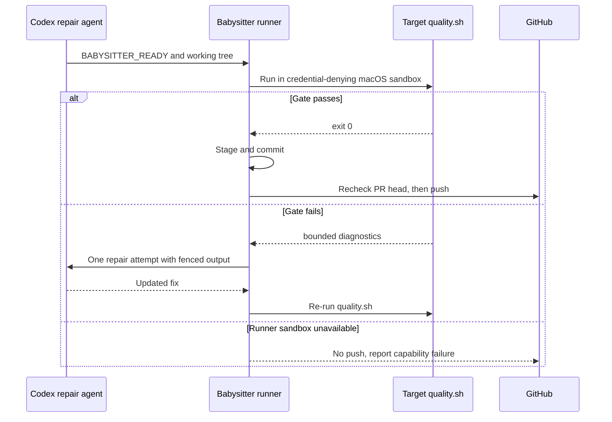

# Fleet PR babysitter MVP

The babysitter scans the repositories in `.config.json` for open fleet PRs with
merge conflicts, outdated branches, failed CI or requested review changes. By
default it fixes candidates. It takes the same PR branch lock as the fleet's CI
and conflict workers, rechecks the head, and runs one Codex session in a
temporary clone. Up to two independent PR repairs run at once, each with a
90-minute Codex limit and its own branch lock. While repairs run, it rescans
every five minutes and queues newly actionable PRs without starting two repairs
for the same PR. After Codex reports a completed fix, the babysitter runs the
target repository's `quality.sh` before staging or committing on macOS. Linux
retains validation inside the existing Codex permissions profile; its prompt
requires the applicable local checks, and the runner does not inspect the gate
script on Linux. It does not run repository code in the privileged runner. On macOS, that
runner-owned check runs outside Codex's browser-restricting profile, under a
separate sandbox that denies the worker configuration, configured credential
paths, the user's Keychains directory and `securityd`; it receives no
credential-shaped environment variables and keeps the clone's `.git` read-only.
The runner permits only named logging, notification, font and WindowServer
Mach lookups, plus lookup and registration of browser rendezvous and
Crashpad name prefixes (children look up the rendezvous server their parent
registers). Process/container and file-service lookups remain denied; a named
lookup alone cannot authorise Chromium's
`bootstrap_check_in` during startup. Registration is limited to those browser
prefixes rather than arbitrary system service names.
The selected babysitter App key and its canonical target are denied even when
setup used a custom `--key` location. The policy file lives in a fresh
runner-owned directory outside the agent's clone and scratch write grants;
neither the agent nor the gate can replace it through scratch, and the runner
removes the directory after validation. Before reading `quality.sh`, the runner
requires a regular file directly in the canonical repository root, rejects
symlinks and special files, and caps both its size and the read at 64 KiB.
Relative `CONFIG_PATH` values (including the default `.config.json`) resolve
against the runner's working directory before constructing protected paths.
This lets browser checks launch Chromium without giving the check runner the
listed credentials. `BABYSITTER_READY` means Codex has finished its repair and
the runner may validate it; it does not mean `quality.sh` passed. A failed check
is returned to Codex once with bounded output, and the runner repeats the gate
before committing. The gate runs in its own process group; the 15-minute
timeout sends SIGKILL to the whole group and closes inherited output pipes. Git staging, commit and push disable hooks as
defence in depth. The .git and securityd denials follow overlapping allows in
the profile. A retry may also replace the first PR-description proposal.
Before it starts any Codex session on macOS, the runner proves the gate can
run: when the clone has a `quality.sh`, it applies the same sandbox profile to
a fixed `/usr/bin/true` probe. An unavailable sandbox (for example
`sandbox_apply: Operation not permitted`) skips that PR with no attempt record
and no agent session, so a watch pass does not spend a repair session on every
cycle; the same classification after the agent finishes remains as a backstop.
Browser cache variables (`PLAYWRIGHT_BROWSERS_PATH`, `CYPRESS_CACHE_FOLDER`,
`PUPPETEER_CACHE_DIR`) that the operator has not set default to fresh
directories under repair scratch that hold links to the host's installed
builds (dot entries such as installer locks are not mirrored). They sit inside
the gate's write grant, so a gate that runs `playwright install` can create
its lock and fetch a missing revision, while installed builds are reused.
Operator-set values are left unchanged.
An unavailable sandbox is reported and prevents a push so a later pass can
retry. Repositories without `quality.sh` have no runner-owned local gate. After
validation, the babysitter checks for
whitespace errors and conflict markers, commits locally, and rechecks the PR.
It pushes only if the PR still matches the original head. Once a review fix is
pushed, the babysitter dismisses the addressed review if it is still the current
review and the PR head has not changed. GitHub CI then runs the repository's
quality and regression checks on the updated branch.



The shared repository list stays unchanged. The babysitter monitors only the
configured repositories accessible to its selected GitHub App installation and
logs each skipped repository. For example, an App installed only on
`stSoftwareAU` skips private `TitlePage` repositories in the same configuration.
Access is rediscovered at the start of each pass, including in `--watch` mode;
write tokens are scoped to the accessible configured subset. An explicitly
requested inaccessible `--repo` fails, as do discovery errors or an empty
accessible subset. Access changes during a pass remain API errors and are
re-evaluated on the next pass.

From the VibeCoder checkout:

```sh
# Interactive setup and preflight. It asks whether to install a launch agent;
# answer no until you have manually tested a fix.
./fleet-pr-babysitter/setup.sh

# Report candidates only; no model calls or PR changes.
./fleet-pr-babysitter/run.sh --dry-run

# Fix candidates in one pass.
./fleet-pr-babysitter/run.sh

# Limit a first execution to one monitored PR.
./fleet-pr-babysitter/run.sh --repo=owner/name --pr=123

# Repeat every five minutes, after each pass finishes.
./fleet-pr-babysitter/run.sh --watch
```

Setup prompts for the GitHub App ID and private-key path, discovers the App
installation, and verifies its permissions, repository access and GraphQL quota
without printing credentials, then saves the App settings for run.sh and adds
its bot to this host's fleet-lock identities. It checks and required commands.
For a non-interactive preflight, use `--check` and `--app-id=<id>`; the key
defaults to `~/.vibe-coder/fleet-pr-babysitter.private-key.pem`, or pass
`--key=<path>`.

On the always-on Mac, rerun setup after manual testing and answer yes to the
launch-agent question. You must also type `INSTALL` to confirm. Setup checks
that the App bot is a configured fleet identity, creates a new launchd job and
starts it; it refuses to overwrite an existing job. Every fleet host must trust
the App's branch locks. To stop the agent, use the `launchctl bootout` command
printed by setup. Launchd starts one pass every five minutes and starts another
after a process failure.

Manual and launchd runs keep their output under
`~/.vibe-coder/fleet-pr-babysitter/logs`. Each completed pass is compressed; the
newest 30 compressed logs are retained, with each pass limited to 10 MiB before
compression. These logs may contain model output and are private to the host
user; do not publish them. If a process is interrupted or compression fails, its
uncompressed log remains available for diagnosis and the next pass retries
compression after confirming that its owner has exited. Each pass also removes
its temporary PR clones after use. A later pass removes clones left by an
interrupted babysitter after confirming their owner exited; it leaves live and
unrelated directories alone.

An optional executable `~/.vibe-coder/fleet-pr-babysitter/health-hook` receives
the pass exit code as its sole argument. It is bounded to ten minutes; hook
failure is logged and the next pass retries. Organisation-specific extensions
can use this to publish a separate babysitter heartbeat and failure record. Dry
runs and runs limited to a repository or PR do not report service health.

The host needs `gh`, `git` and `deno`. Codex CLI must be 0.164.0 or newer,
because older versions may silently ignore the permissions profile; a
pre-release counts when its base version is newer (0.166.0-alpha passes,
0.164.0-beta does not). Setup and each repair check the `codex` on PATH before
minting an agent token. When it is missing, too old or unrecognised, they
install the Codex version pinned in `container/tools.json` (CLI and code-mode
host, macOS or Linux, each archive verified against its pinned SHA-256) under
`~/.vibe-coder/codex/<version>-<target>/` and run that instead, so an
unattended host needs no manual upgrade. When RTK is available, each
repair receives instructions to use it; otherwise the babysitter logs a warning
and continues without it. Before execution, put the App's `<slug>[bot]` login in
`service_accounts` or `fleet_pr_authors` **on every fleet host**. Run setup on
each host (or deploy your organisation's fleet configuration) before starting
repairs. Those workers only trust locks written by known fleet accounts. The MVP
checks the local configuration; it cannot verify other hosts. Use a dedicated
account with only the access it needs. An operator may also configure a trusted
Codex RTK hook on each host. Each repair activates the worker-side GitHub write
allowlist for its target repository, including lock comments, branch updates and
review dismissals. Concurrent repairs use separate scopes. Codex runs with
approvals disabled, under a per-spawn Codex permissions profile
(`default_permissions` and a `permissions.<profile>.filesystem` inline table
passed as one `-c` value) that reads the filesystem, writes only the temporary
clone (its `.git` read-only) and scratch directory, and has no access (`none`)
to the babysitter App private key, the worker credential directory, the host
`gh` config directory, configured reviewer and worker App keys, configured
service-account SSH key, the `~/.vibe-coder/fleet-pr-babysitter*` entries and
their resolved symlink targets. Credential locations are read from the same
`CONFIG_PATH` file and host environment as the worker, including the documented
defaults `~/.vibe-coder/credentials` and `~/.config/gh`. The configured spelling
is resolved with filesystem traversal semantics, so `..` after a directory
symlink follows the target's parent. Normalised locations and their canonical
targets are also denied; missing tails are resolved through the longest existing
parent. These entries are denied because the agent shares the runner's
OS user and file modes alone do not protect them; it is also told not to ask
questions. When a fix
needs a human decision, it should report the blocker and stop without a commit.
The sandbox still applies; an unavailable permission or credential can stop a
run and must be corrected by the operator. Codex gets its own installation
token, minted per repair for the target repository only, with read-only
permissions (contents, pull requests, issues, checks, actions). Every GitHub
write (lock, push, branch update, review dismissal, PR description) is made by
the runner with its own token. The agent token lasts about an hour and is not
refreshed, so reads late in a longer repair can fail. When a review asks for a
description change, the agent writes the full new description to
`.babysitter-pr-body` in the clone; the runner removes it before committing and
applies it after the push (or when there is no code change), re-adding any
closing reference such as `Closes #N` the proposal dropped.

The profile explicitly enables network access so the agent can fetch GitHub
feedback and check details. Host `[sandbox_workspace_write]` settings do not
apply to this profile: `network_access` and `writable_roots` are not inherited,
and `/tmp` is not automatically writable. The agent can write to its assigned
clone and scratch directory instead.

**Verifying the credential boundary.** The permissions-profile keys were written
without an installed Codex to test against. The paths are passed as the keys of
one inline-table value, not as dotted `-c` keys, because Codex splits a `-c` key
on every dot and every protected path contains dots. After upgrading Codex or
changing the key path, confirm on the host that the agent cannot read the key:
run a one-off `codex exec` with the same `-c` overrides the babysitter passes
(built by `buildBabysitterSandboxArgs` in
`worker/deno/lib/fleet_babysitter_sandbox.ts`), ask it to `cat` the App private
key, and expect a denied read. The GitHub token handed to the agent stays
read-only. This is a path denylist derived from the worker configuration and
documented host defaults, not a guarantee that every credential on a host is
unreadable.

Fleet-wide scans consider only fleet-authored, non-draft, same-repository PRs.
A PR labelled `needs-human` is never a candidate: it waits on a person, for
example a check that declared a human gate.
An explicitly selected `--repo` scans that repository regardless of PR author;
`--pr` narrows the scan to one PR. Both retain the same lock and validation. A
red check whose workflow runs were cancelled rather than failed (every run on
the head finished, one or more cancelled, none failed) starts no agent: the
runner asks GitHub to re-run the cancelled runs, once per head. That needs the
App's `actions: write` permission; with `actions: read` the re-run is refused
and logged as a WARNING naming the permission. A
PR that a fleet worker holds a live PR-feedback lease claim on
(`PR_COMMENT_CLAIM` with an unexpired `PR_COMMENT_CLAIM_LEASE`) is skipped for
that pass, so the babysitter never repairs beside a worker that is about to
push. A failed or unproductive agent attempt is recorded under
`${XDG_STATE_HOME:-$HOME/.local/state}/vibe-coder/fleet-pr-babysitter` and is
not retried on that host for the same PR head. A review repair is keyed on the
head and the newest change-request review, so a new review on an attempted head
gets its own attempt. Removing the matching state file permits a retry. The shared lock prevents simultaneous work; this local attempt
record does not prevent a different host from retrying later.

## Shift-left detection

A fleet PR that fails CI costs a CI run and a second agent session to repair
it. Each pass, before it starts repairs, the babysitter looks for CI failures
that keep recurring on fleet PRs and that a check on the Mac could have caught
before the PR was raised (Issue #4610). It does not weaken any check; it moves
the same check earlier.

- It reads the PR workflow runs that failed since its last scan and records one
  observation per failed job of a fleet PR. A job counts only when its failed
  step runs a recognised local tool (`cargo clippy`, `cargo fmt`,
  `cargo mutants`, `cargo llvm-cov`, `deno test`, `markdownlint` and so on) and
  the CI failure classifier calls it a code fault. Infrastructure, timing,
  aggregator and deployment-state failures never count.
- When the same check and step fail on 3 or more distinct fleet PRs within 7
  days, it files one issue in the repository that owns the fix:

  | Situation | Filed in |
  | --- | --- |
  | Most failing heads were pushed by the babysitter itself | VibeCoder |
  | The repository's `quality.sh` already runs the tool, so the fleet raised or pushed without a passing local gate | VibeCoder |
  | CI runs the tool but no local gate does, in 2 or more repositories | VibeCoder, once (a fleet-wide gap) |
  | CI runs the tool but this repository's local gate does not | That repository |

- A repository's VibeCoder-routed checks are filed as one issue that lists
  every tool, because they share one cause.
- Issues carry the `idle-task` label, so the fleet picks them up without a
  human label. A recurrence adds at most one comment a day to the open issue; a
  recurrence after the issue was closed files a new issue that links the old
  one. A VibeCoder issue about a private repository names neither the
  repository nor its PRs.
- Each pass inspects at most 40 failed runs per repository and remembers the
  runs it has scanned, so a busy repository's backlog does not delay repairs;
  later passes pick up the rest.
- The ledger is `shift-left-ledger.json` in the babysitter state directory. A
  dry run records observations and reports what it would file, but writes
  nothing to GitHub. A run limited with `--pr` skips detection.

Codex still runs checks it can safely run inside its per-spawn profile. The
macOS runner owns the final local `quality.sh` result for every repair, including
browser checks Codex cannot launch. A failed runner check is fed back for one
repair attempt and must pass on revalidation before commit; a missing runner
sandbox is reported as unavailable and does not produce a commit or push. The
runner clears the attempt record for this unavailable-capability case so a
later pass can retry.

This MVP uses the configured GitHub App and Codex; it does not yet select
providers by remaining quota, handle Dependabot, select per-repository quality
commands, review PRs, or arm auto-merge. It does not change repository CI,
review, or merge rules. Test the read-only pass before running execution mode.

To prepare a separate GitHub identity and API quota, follow the
[babysitter GitHub App setup](fleet-pr-babysitter-github-app.md).


### Browser integration check

Run `cd worker/deno && deno task test:browser < /dev/null` on macOS with
`CHROMIUM_PATH` pointing to a Chromium executable. This dedicated integration
suite requires sandbox-exec and the macOS Keychain services. It fails loudly
when prerequisites are absent. The ordinary unit suite uses self-contained
command doubles and requires no browser. Linux repairs keep their existing
agent validation and the credential boundary from #4593.

### Installed browser caches

The gate uses scratch HOME. Unset `PLAYWRIGHT_BROWSERS_PATH`,
`CYPRESS_CACHE_FOLDER` and `PUPPETEER_CACHE_DIR` default to writable
directories under repair scratch, with links to installed builds in the host's
home. Installer state such as dot entries is not mirrored, so the gate can
create its own locks and install missing builds. Explicit values of these three
variables are preserved. Browser runtime profiles and temporary files belong
in scratch. The runner first executes
`/usr/bin/true` under the same policy. A failed sandbox startup is unavailable,
does not trigger an agent repair retry, and releases the attempt record.
